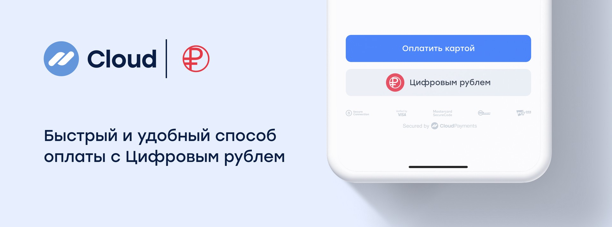

# Цифровой рубль

## Прием цифровых рублей с 1 сентября 2026 года

Цифровой рубль — цифровая форма российской национальной валюты, которую выпускает Банк России. Он равен наличному рублю и используется для платежей через платформу Банка России.

## На кого распространяются требования

С 1 сентября 2026 года принимать цифровые рубли должны будут продавцы и исполнители, которые одновременно:

* Получили за предыдущий год выручку более 120 млн рублей
* Работают с банком, признанным значимым на рынке платежных услуг
* Принимают оплату от физических лиц

## Как будут расширяться требования

С 1 сентября 2027 года требования распространятся на компании с выручкой более 30 млн рублей, а с 1 сентября 2028 года — на остальных продавцов с выручкой от 20 млн рублей.

## На кого требования не распространяются

Компании с совокупной годовой выручкой менее 20 млн рублей не обязаны принимать цифровые рубли.

Требование также не распространяется:

* На отдельные торговые точки с выручкой менее 5 млн рублей в год, даже если совокупная выручка всей компании превышает 20 млн рублей
* На точки продаж без доступа к интернету

## Прием цифровых рублей в CloudPayments

CloudPayments планирует запустить прием разовых платежей в цифровых рублях с 1 сентября 2026 года. Операции будут отображаться в Личном кабинете и включаться в реестры и отчетность.

До конца 2026 года комиссия за прием платежей в цифровых рублях составит 0%. Регулярные платежи и сохранение счета для повторных оплат на старте поддерживаться не будут.

## Как подключить

Если вы уже принимаете платежи через CloudPayments, обратитесь к своему менеджеру или напишите в чат поддержки в Личном кабинете.

Если вы еще не работаете с CloudPayments, оставьте [заявку на подключение](https://cloudpayments.ru/#section-request).

Документацию по интеграции мы предоставим действующим клиентам по запросу, а новым — после подключения.
