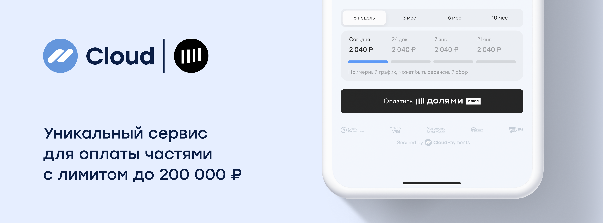

# Долями



CloudPayments предлагает метод оплаты Долями. Пользователь может разделить оплату на четыре части, а магазин получит всю сумму на следующий рабочий день.

## Способы интеграций
* в платежном [виджете](mpf.md) и [CMS](https://cloudpayments.ru/integration/cms)-/[CRM](https://cloudpayments.ru/integration/crm)-модулях
+ в [CloudИнфошопе](https://cloudpayments.ru/infoshop) (формирование витрины из Личного кабинета) 
* в [заказах](api/22-sozdanie-scheta-dlya-otpravki-po-pochte.md)
* в платежных ссылках, которые формируются из Личного кабинета
* в API

## Подключение

Для подключения способа оплаты необходимо обратиться к курирующему менеджеру или написать на адрес электронной почты – [assistant@cp.ru](mailto:assistant@cp.ru)

По техническим вопросам обращайтесь в службу поддержки – [support@cp.ru](mailto:support@cp.ru)


## Встраиваемая кнопка оплаты

Вы можете добавить на свой сайт кнопку оплаты Долями. Данный способ работает через публичный API CloudPayments и позволяет встраивать на вашей форме отдельную кнопку оплаты.

Интерфейс работает по адресу [api.cloudpayments.ru](https://api.cloudpayments.ru/)

### Метод POST /payments/altpay/pay

Метод предназначен для получения ссылки на оплату через заполнение заявки Долями

Авторизация [HTTP Basic Auth](https://en.wikipedia.org/wiki/Basic_access_authentication) для данного метода отсутствует. Вместо нее используется параметр идентификатора терминала `PublicId` в теле запроса.

**URL:** /payments/altpay/pay

**METHOD:** POST

**BODY:**
Запрос обязательно имеет не пустое тело запроса.

| Параметр | Формат | Применение  | Описание | Пример |
|---|---|---|---|---|
| PublicId | String | Обязательный | Идентификатор терминала. | `pk_0fe1d5c9cb47e8cf8d96102201419` |
| AltPayType | String | Обязательный | Тип оплаты.<br />Необходимо передавать значение "TcsBnplDolyame". | `TcsBnplDolyame` |
| Amount | Number<br />  | Обязательный | Cумма платежа, разделитель точка. Количество не нулевых знаков после точки – 2. | `1000` |
| Scheme | enum<br />String | Обязательный | Схема проведения платежа (см. [Виды операций](handbook.md#типы-операций)).<br />Возможные значения: <br />`0` - одностадийная оплата; <br />`1` - двухстадийная оплата | `0` |
| InvoiceId | String | Необязательный | Идентификатор заказа/номер счета.<br />Приходит в [Check](notifications.md#check)-уведомлении и может использоваться для сверки номера заказа. | `462651419` |
| Description | String | Необязательный | Описание заказа/оплаты в свободной форме | `Оплата товаров в https://example.com` |
| AccountId | String | Необязательный | Идентификатор плательщика | `usermail@example.com` |
| Email | String | Необязательный | E-mail плательщика, на который будет отправлена квитанция об оплате | `usermail@example.com` |
| SuccessRedirectUrl | String | Необязательный | Ссылка для возврата в случае успешной оплаты | `https://success-page.ru` |
| FailRedirectUrl | String | Необязательный | Ссылка для возврата в случае неуспешной оплаты | `https://fail-page.ru` |
| JsonData | Json | Необязательный | Любые другие данные, которые будут связаны с транзакцией в формате объекта `json`. | `{\"Phone\": \"+71234567890\"}` |
| CultureName | String | Необязательный | Язык уведомлений и квитанций. Возможные значения: "ru-RU", "en-US". (см. [справочник](api/26-lokalizatsiya.md)).<br />Если не передан, по умолчанию будет использоваться "ru-RU”. | `ru-RU` |

**RESPONSE:**

В ответ сервер возвращает JSON с тремя составляющими:

* **поле success** — результат запроса;
* **поле message** — описание ошибки;
* **объект model** — расширенная информация о платеже.

Возможные варианты ответа:

1. Некорректно сформирован запрос:
   * **success** — false
   * **message** — описание ошибки
2. Инициализация платежной сессии завершилась неуспешно:
   * **success** — false
   * **model** — информация о транзакции и код ошибки
3. Инициализация сессии прошла успешно:
   * **success** — true
   * **model** — информация о транзакции 
     * В поле `Model.ExtensionData.Link` придет ссылка на платежную форму, которую необходимо открыть для последующей оплаты пользователем через оформление заявки на данной платежной форме

<aside class="notice">Результат запроса (поле Success) не отражает статус транзакции, а лишь свидетельствует об успешности/неуспешности запроса API. Статус транзакции отражен в дополнительном поле Status, также его можно узнать в результате получения <a href="notifications.md">уведомлений</a>. Интерпретацию статусов транзакции смотрите в <a href="handbook.md#статусы-операций">справочнике</a>.</aside>

| Параметр | Формат | Наличие | Описание |
|---|---|---|---|
| Model | Object | Обязательный | Данные созданной транзакции |
| Model.TransactionId | Long | Обязательный | ID Транзакции |
| Model.Amount | Number | Обязательный | Сумма транзакции |
| Model.IsTest | Bool | Необязательный | Флаг тестового режима оплаты |
| ExtensionData | Object | Необязательный | Объект с дополнительными данными платежа |
| ExtensionData.Link<br />  | String | Необязательный | Ссылка на форму заявки на [сайтe](http://dolyame.ru/) |
| Success | Bool | Обязательный | Успешность запроса |
| Message | String | Необязательный | Сообщение, описывающее статус запроса |
| ErrorCode | Number | Необязательный | Код ошибки (при наличии) |

**Пример запроса**

```llvm
{
  "PublicId": "pk_0fe1d5c9cb47e8cf8d96102201419",
  "AltPayType": "TcsBnplDolyame",
  "Amount": 1000,
  "Description": "Оплата в точке N",
  "AccountId": "email@email.com",
  "InvoiceId": "order_no4009",
  "CultureName": "ru-RU",
  "Scheme": "1",
  "SuccessRedirectUrl": "https://success-page.ru",
  "FailRedirectUrl": "https://fail-page.ru"
  
}       
```

**Пример ответа**

```llvm
{
  "Model": {
          "TransactionId": 183930901,
          "Amount": 1000,
          "IsTest": true
          },
  "ExtensionData": {
                "Link": "https://dolyame.ru/form/demoPayment-52030933-b65e-4e5a-acdc/example/example"
                },
  "Success": true,
  "Message": null,
  "ErrorCode": null
}
```
