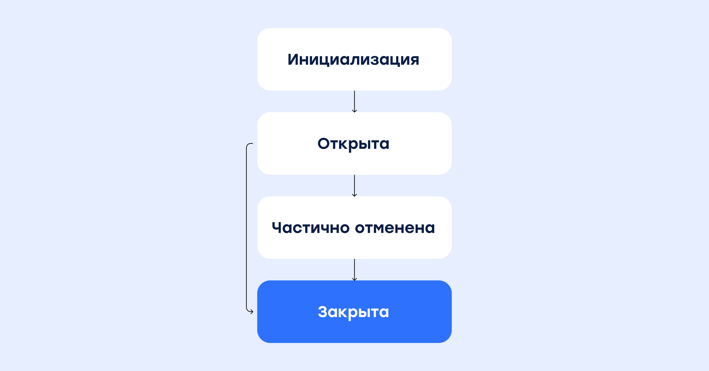

# Безопасная сделка

## Описание продукта

Сервис "Безопасная сделка" позволяет организовать взаиморасчеты между двумя физическими лицами при продаже услуг или товаров. При этом, взаимодействие между физическими лицами происходит не напрямую между собой, а при участии Площадки - юридического лица, которое организует размещение Товара на своей витрине, помогает Продавцу найти покупателя, а также организует арбитраж, в случае такой необходимости. Площадка контролирует ход выполнения сделки, и дает команду CloudPayments на списание с карты в момент покупки, а после успешного выполнение продавцом своих обязанностей (например, после исполнения оговоренных услуг или работ, либо после успешной доставки товара), инициирует выплату на карту продавцу.  

## Определения и термины:

**Плательщик** - физическое лицо, которое отправляет денежные средства.  
**Получатель** - физическое лицо, которое получает денежные средства.  
**Площадка** - посредник, который выступает гарантом безопасности сделки, принимает решение о выполнении сторонами своих обязательств. В спорных случаях выступает Арбитром в спорах и несет финансовую ответственность.  
**Сделка** - процесс приобретения товара/услуги одним физическим лицом у другого.  
**Оплата** - приобретение товара/услуги у физического лица.  
**Выплата** - получение вознаграждения физического лица, оказавшего услугу/продавцу товара.  
**Widget** - всплывающая форма для ввода реквизитов карты и e-mail адреса плательщика.  
**Checkout** - скрипт, который прописывается на сайте, собирает из указанной формы карточные данные и составляет из них криптограмму для оплаты через API.  
**AccumulationId** - уникальный идентификатор сделки, присваиваемый во время первой операции.
**TransactionId** - уникальный идентификатор транзакции.  

## Настройка подключения:

Для подключения продукта "Безопасная сделка" необходимо подать заявку своему персональному менеджеру или указать это на этапе подключения выделенному менеджеру.

<aside class="warning">Для работы по БС требуется заведение 2 терминалов, один для оплат, второй для выплат</aside>

<aside class="warning">Оплаты и выплаты по БС  доступны только по карте или по токену, полученному при оплате картой. На других способах оплаты, включая международные платежи по карте, БС не поддерживается.<br /><br />Также не все банки эквайеры, подключенные в CloudPayments, работают с БС. За деталями обращайтесь к своему персональному менеджеру.</aside>

## Cхемы работы

1. Накопление нескольких платежей и проведение единой выплаты (N:1)
2. Разделение одного платежа на несколько выплат (1:N)

## Статусная модель сделки



## N:1

### Схема интеграции для Widget: 

Переменная содержащая тип сделки, которая содержится в объекте cp.constant.escrow. Она отвечает за схему проведения сделки:

1. Множество оплат и одна выплата;

2. Одна оплата и множество выплат.

```llvm
{
  NToOne: 0,  // для схемы N:1
  OneToN: 1  // для схемы 1:N
}
```

Если данная переменная не передается, система автоматически считает, что сделка производится по протоколу **N:1**.

**Пример использования**:

```yaml
cp.constant.escrow.NToOne // переменная для типа сделки = 0
cp.constant.escrow.OneToN // переменная для типа сделки = 1
```

**Оплата (первичное создание накопления)**

```js
var widget = new cp.CloudPayments();

  const intentParams = {
    publicTerminalId: "test_api_00000000000000000000002",
    paymentSchema: 'Dual',
    description: "Оплата заказа №...",
    amount: 100,
    currency: "RUB",
    culture: "ru-RU",
    skin: "classic",
    externalId: 'string',
    receiptEmail: "user@email.com",
    userInfo: {
      email: "user@email.com",
      phone: "+71234567890",
    },
    metadata: {
      myProp: "myProp value",
    },
    escrow: {
      startAccumulation: true,
      accumulationId: null,
      escrowType: "NToOne"
    },
  };

  widget.oncomplete = (result) => {
      console.log(result);
  }

  widget.start(intentParams).then(function(widgetResult) {
    console.log('result', widgetResult); // действие при успехе
  }).catch(function(error) {
    console.log('error', error); // действие при ошибке
  });
```

В ответ на запрос, в [Pay](notifications.md#pay) уведомлении будет получен уникальный **EscrowAccumulationId**.

Также, при условии успешной транзакции, **EscrowAccumulationId** будет содержаться во всех вебхуках, кроме Check вебхука.

**Оплата (по созданному накоплению)**

Для последующих запросов (оплат), в рамках созданной безопасной сделки, необходимо добавить поля **accumulationId**, **startAccumulation**, **escrowType** в объект `escrow`.

**Пример**:

```js
Escrow:{
    startAccumulation: false,
    escrowType: cp.constant.escrow.NToOne,
    accumulationId: "4733183a-c6f6-4c1b-8ff1-fb7c43ed1695" // - Оплата по уже созданному накоплению.
}
```


### Схема интеграции для API Checkout: 

**Оплата (первичное создание накопления)**

Необходимо использовать запрос **payments/cards/charge** (либо **auth**), где в теле в теле запроса в объекте `escrow` нужно передать `"StartAccumulation": true` и тип сделки `"EscrowType":0` или `"EscrowType": “NToOne"` . То есть для `EscrowType` значения можно передавать как целочисленное значение (0/1), так и строковым представлением (NToOne/OneToN).

```json
"Escrow":{
    "StartAccumulation":true,
    "EscrowType": "NToOne"
}
```

В ответ на запрос будет получен уникальный `EscrowAccumulationId`.

```json
{
    "Model": {
        "ReasonCode": 0,
        "PublicId": "pk_71efb26a18397ec61b755221123cc",
        "TerminalUrl": "https://example.com",
        "TransactionId": 10649404,
        "Amount": 215,
        "Currency": "RUB",
        "CurrencyCode": 0,
        "PaymentAmount": 215,
        "PaymentCurrency": "RUB",
        "PaymentCurrencyCode": 0,
        "InvoiceId": null,
        "AccountId": null,
        "Email": null,
        "Description": null,
        "JsonData": "{\"Phone\": \"+71234567890\" }",
        "CreatedDate": "/Date(1640787010601)/",
        "PayoutDate": null,
        "PayoutDateIso": null,
        "PayoutAmount": null,
        "CreatedDateIso": "2021-12-29T14:10:10",
        "AuthDate": "/Date(1640787010877)/",
        "AuthDateIso": "2021-12-29T14:10:10",
        "ConfirmDate": null,
        "ConfirmDateIso": null,
        "AuthCode": "A1B2C3",
        "TestMode": true,
        "Rrn": null,
        "OriginalTransactionId": null,
        "FallBackScenarioDeclinedTransactionId": null,
        "IpAddress": "127.0.0.1",
        "IpCountry": "RU",
        "IpCity": "Новосибирск",
        "IpRegion": "Новосибирская область",
        "IpDistrict": "Сибирский федеральный округ",
        "IpLatitude": 1.03923,
        "IpLongitude": 1.927818,
        "CardFirstSix": "411111",
        "CardLastFour": "1111",
        "CardExpDate": "11/23",
        "CardType": "Visa",
        "CardProduct": "C",
        "CardCategory": "Visa Signature (Signature)",
        "EscrowAccumulationId": "365b6942-94e8-4c5b-aff5-392dc1a51c28",
        "IssuerBankCountry": "RU",
        "Issuer": "CloudPayments",
        "CardTypeCode": 0,
        "Status": "Authorized",
        "StatusCode": 2,
        "CultureName": "ru",
        "Reason": "Approved",
        "CardHolderMessage": "Оплата успешно проведена",
        "Type": 0,
        "Refunded": false,
        "Name": null,
        "Token": null,
        "SubscriptionId": null,
        "GatewayName": "Test",
        "AndroidPay": false,
        "WalletType": "",
        "TotalFee": 0
    },
    "Success": true,
    "Message": null
}
```

В ответ на запрос, в [Pay](notifications.md#pay) уведомлении будет получен уникальный EscrowAccumulationId.

Также, при условии успешной транзакции, `EscrowAccumulationId` будет содержаться во всех вебхуках, кроме Check вебхука.

**Оплата (по созданному накоплению)**

Для последующих запросов (оплат), в рамках созданной безопасной сделки, необходимо добавить в запрос **payments/cards/charge AccumulationId** в объект `Escrow` с указанием `"StartAccumulation": false` и тип сделки `"EscrowType":0` или `"EscrowType": “NToOne"`:

```json
"Escrow":{
    "StartAccumulation":false,
    "EscrowType": "NToOne", 
    "AccumulationId": "365b6942-94e8-4c5b-aff5-392dc1a51c28",
}
```

Ответ:

```json
{
    "Model": {
        "ReasonCode": 0,
        "PublicId": "pk_71efb26a18397ec61b755221123cc",
        "TerminalUrl": "https://example.com",
        "TransactionId": 10649405,
        "Amount": 215,
        "Currency": "RUB",
        "CurrencyCode": 0,
        "PaymentAmount": 215,
        "PaymentCurrency": "RUB",
        "PaymentCurrencyCode": 0,
        "InvoiceId": null,
        "AccountId": null,
        "Email": null,
        "Description": null,
        "JsonData": "{\"Phone\": \"+71234567890\"}",
        "CreatedDate": "/Date(1640787317880)/",
        "PayoutDate": null,
        "PayoutDateIso": null,
        "PayoutAmount": null,
        "CreatedDateIso": "2021-12-29T14:15:17",
        "AuthDate": "/Date(1640787319410)/",
        "AuthDateIso": "2021-12-29T14:15:19",
        "ConfirmDate": null,
        "ConfirmDateIso": null,
        "AuthCode": "A1B2C3",
        "TestMode": true,
        "Rrn": null,
        "OriginalTransactionId": null,
        "FallBackScenarioDeclinedTransactionId": null,
        "IpAddress": "127.0.0.1",
        "IpCountry": "RU",
        "IpCity": "Новосибирск",
        "IpRegion": "Новосибирская область",
        "IpDistrict": "Сибирский федеральный округ",
        "IpLatitude": 1.03923,
        "IpLongitude": 1.927818,
        "CardFirstSix": "411111",
        "CardLastFour": "1111",
        "CardExpDate": "11/23",
        "CardType": "Visa",
        "CardProduct": "C",
        "CardCategory": "Visa Signature (Signature)",
        "EscrowAccumulationId": "365b6942-94e8-4c5b-aff5-392dc1a51c28",
        "IssuerBankCountry": "RU",
        "Issuer": "CloudPayments",
        "CardTypeCode": 0,
        "Status": "Authorized",
        "StatusCode": 2,
        "CultureName": "ru",
        "Reason": "Approved",
        "CardHolderMessage": "Оплата успешно проведена",
        "Type": 0,
        "Refunded": false,
        "Name": null,
        "Token": null,
        "SubscriptionId": null,
        "GatewayName": "Test",
        "AndroidPay": false,
        "WalletType": "",
        "TotalFee": 0
    },
    "Success": true,
    "Message": null
}
```

**Выплата**

Для завершения сделки необходимо отправить запрос **payments/token/topup** с указанием `AccumulationId` и массива транзакций к выплате:

```json
"Escrow": {
  "AccumulationId": "365b6942-94e8-4c5b-aff5-392dc1a51c28", 
  "TransactionIds": [10649405, 10649404],
  "EscrowType": "NToOne"
}
```

Массив транзакций оплаты для выплаты должен должен содержать только транзакции, которые проводились по терминалу оплаты с текущим **AccumulationId**.
Выплата будет осуществлена только по тем **TransactionId**, которые были указаны в **TransactionIds** в запросе **payments/token/topup**.
По неуказанным транзакциям, провести выплату не возможно, т.к. сделка будет уже закрытой. Т.е. по закрытой сделке невозможно сделать как оплату, так и выплату.

<aside class="warning">По транзакциям оплаты, которые не были переданы для закрытия сделки будет осуществлен возврат денежных средств плательщику.</aside>
  
### Ограничения

Сумма выплат должна быть меньше, либо равна сумме оплат.

Ни по одной из транзакций, указанных в массиве транзакций для выплаты не должно быть отмен/полных возвратов (частичные возвраты производить можно). 
 
Если запрос на оплату приходит с `AccumulationId`, а по нему уже есть выплата - оплата будет отклонена.  

Все транзакции для выплаты должны быть:  

* с одинаковым AccumulationId  
* не выплачены   
* в валюте "рубль"  
* типа **Payment**  
* в статусе **Completed**  

## 1\:N

### Схема интеграции для Widget: 

Переменная содержащая тип сделки, которая содержится в объекте cp.constant.escrow. Она отвечает за схему проведения сделки:

    1. Множество оплат и одна выплата;

    2. Одна оплата и множество выплат.

```llvm
{
  NToOne: 0,
  OneToN: 1
}
```

**Пример использования**:

```yaml
cp.constant.escrow.NToOne // переменная для типа сделки = 0
cp.constant.escrow.OneToN // переменная для типа сделки = 1
```

**Оплата**

```js
var widget = new cp.CloudPayments();

  const intentParams = {
    publicTerminalId: "test_api_00000000000000000000002",
    paymentSchema: 'Dual',
    description: "Оплата заказа №...",
    amount: 100,
    currency: "RUB",
    culture: "ru-RU",
    skin: "classic",
    externalId: 'string',
    receiptEmail: "user@email.com",
    userInfo: {
      email: "user@email.com",
      phone: "+71234567890",
    },
    metadata: {
      myProp: "myProp value",
    },
    escrow: {
      startAccumulation: true,
      accumulationId: null,
      escrowType: "OneToN"
    },
  };

  widget.oncomplete = (result) => {
      console.log(result);
  }

  widget.start(intentParams).then(function(widgetResult) {
    console.log('result', widgetResult); // действие при успехе
  }).catch(function(error) {
    console.log('error', error); // действие при ошибке
  });
```

В ответ на запрос, в [Pay](notifications.md#pay) уведомлении будет получен уникальный **EscrowAccumulationId**.

Также, при условии успешной транзакции, EscrowAccumulationId будет содержаться во всех вебхуках, кроме Check вебхука.

### Схема интеграции для API Checkout: 

**Оплата**

Необходимо использовать запрос **payments/cards/charge** (либо **auth**), где в теле в теле запроса в объекте `escrow` нужно передать `"StartAccumulation": true` и тип сделки `"EscrowType":1` или `"EscrowType": "OneToN"` . То есть для `EscrowType` значения можно передавать как целочисленное значение (0/1), так и строковым представлением (NToOne/OneToN).

```json
"Escrow":{
    "StartAccumulation":true,
    "EscrowType": "OneToN"
}
```

В ответ на запрос будет получен уникальный `EscrowAccumulationId`.

```json
{
    "Model": {
        "ReasonCode": 0,
        "PublicId": "pk_71efb26a18397ec61b755221123cc",
        "TerminalUrl": "https://example.com",
        "TransactionId": 10649404,
        "Amount": 215,
        "Currency": "RUB",
        "CurrencyCode": 0,
        "PaymentAmount": 215,
        "PaymentCurrency": "RUB",
        "PaymentCurrencyCode": 0,
        "InvoiceId": null,
        "AccountId": null,
        "Email": null,
        "Description": null,
        "JsonData": "{\"Phone\": \"+71234567890\"}",
        "CreatedDate": "/Date(1640787010601)/",
        "PayoutDate": null,
        "PayoutDateIso": null,
        "PayoutAmount": null,
        "CreatedDateIso": "2021-12-29T14:10:10",
        "AuthDate": "/Date(1640787010877)/",
        "AuthDateIso": "2021-12-29T14:10:10",
        "ConfirmDate": null,
        "ConfirmDateIso": null,
        "AuthCode": "A1B2C3",
        "TestMode": true,
        "Rrn": null,
        "OriginalTransactionId": null,
        "FallBackScenarioDeclinedTransactionId": null,
        "IpAddress": "127.0.0.1",
        "IpCountry": "RU",
        "IpCity": "Новосибирск",
        "IpRegion": "Новосибирская область",
        "IpDistrict": "Сибирский федеральный округ",
        "IpLatitude": 1.03923,
        "IpLongitude": 1.927818,
        "CardFirstSix": "411111",
        "CardLastFour": "1111",
        "CardExpDate": "11/23",
        "CardType": "Visa",
        "CardProduct": "C",
        "CardCategory": "Visa Signature (Signature)",
        "EscrowAccumulationId": "365b6942-94e8-4c5b-aff5-392dc1a51c28",
        "IssuerBankCountry": "RU",
        "Issuer": "CloudPayments",
        "CardTypeCode": 0,
        "Status": "Authorized",
        "StatusCode": 2,
        "CultureName": "ru",
        "Reason": "Approved",
        "CardHolderMessage": "Оплата успешно проведена",
        "Type": 0,
        "Refunded": false,
        "Name": null,
        "Token": null,
        "SubscriptionId": null,
        "GatewayName": "Test",
        "AndroidPay": false,
        "WalletType": "",
        "TotalFee": 0
    },
    "Success": true,
    "Message": null
}
```

В ответ на запрос, в [Pay](notifications.md#pay) уведомлении будет получен уникальный `EscrowAccumulationId`.

Также, при условии успешной транзакции, `EscrowAccumulationId` будет содержаться во всех вебхуках, кроме Check вебхука.

**Выплата**

Для завершения сделки необходимо отправить запрос **payments/token/topup** с указанием `AccumulationId` и массива транзакций к выплате (в массиве должен содержаться только один `transactionId`, согласно схеме сделки):

```json
"Escrow": {
  "AccumulationId": "365b6942-94e8-4c5b-aff5-392dc1a51c28", 
  "TransactionIds": [10649404],
  "EscrowType": "OneToN"
}
```

<aside class="warning">Выплаты можно производить до тех пор, пока сумма всех выплат не будет равна сумме операции оплаты.</aside>

Для закрытия сделки существует 2 способа:

1. Передать параметр в объект Escrow "FinalPayout": true (сделка закроется, даже если сумма выплат меньше суммы оплаты);

```json
"Escrow": {
  "AccumulationId": "365b6942-94e8-4c5b-aff5-392dc1a51c28", 
  "TransactionIds": [10649404],
  "EscrowType": "OneToN",
  "FinalPayout": true
}
```

2. Когда сумма выплат будет равна сумме операции оплаты, сделка будет автоматически закрыта.

Выплаты будут осуществляться только по тому `TransactionId`, который был указан в массиве `TransactionIds` (для 1:N только один ID операции оплаты) в запросе **payments/token/topup**.

### Ограничения

Сумма выплат должна быть меньше, либо равна сумме оплат.

По транзакции оплаты не должно быть отмены/полного возврата (частичные возвраты производить можно).

Все транзакции выплат должны быть:  

* с одинаковым `AccumulationId`;  
* в валюте "рубль";  
* в статусе **Completed**;  
* все транзакции выплат производятся в одной схеме (OneToN);  
* Сделка не должна быть закрыта (не был передан finalPayout: true, сумма выплат меньше суммы операции оплаты)  

## Получение по AccumulationId статуса операций

Для получения информации требуется отправить http-запрос с типом авторизации “Basic Auth”. 
Логин - public key (pk) терминала. Подойдет как терминал оплаты, так и терминал выплаты.
Пароль - api secret от данного Pk.

<aside class="notice">pk и api secret можно посмотреть в Личном кабинете в настройках сайта.</aside>

<aside class="warning">Получение информация доступно только по тем accumaltionIDs, которые были сформированы в рамках этой связки терминалов.</aside>

## Метод для получения информации по БС для обоих типов сделки (N:1 и 1\:N)

Публичный метод для получения информации по массиву **EscrowAccumulationId**, который позволяет получить:

* Массив оплат, по которым не была сделана выплата  
    * id транзакции **оплаты**  
    * статус транзакции (текстовое значение)  
    * сумма транзакции  
* Массив оплат, по которым была сделана выплата (которые вошли в выплату)  
    * id транзакции **оплаты**  
    * статус транзакции (текстовое значение)  
    * сумма транзакции  
* Массив возвратов по всем транзакциям  
    * id транзакции **оплаты**  
    * статус транзакции (текстовое значение)  
    * сумма транзакции  
* Массив транзакций выплат (для 1:N)  
    * id транзакции **выплаты**  
    * статус транзакции (текстовое значение)  
    * сумма транзакции **выплаты**  
    * признак закрытия сделки **IsFinalPayout**  
* Сальдо (Balance)  
    * Balance = PaymentsSum - RefundsSum - PayoutsSum

**Адрес метода:**

https://api.cloudpayments.ru/Escrow/GetEscrowInfo

**Пример запроса:**  

```json
{
  "EscrowAccumulationIds" : ["7de3281f-4339-4e2e-9df9-06dcfbcdceac"]
}
```

**Пример ответа:**

```json
{
    "Model": [
        {
            "Status": "Closed",
            "PaidoutTransactions": [
                {
                    "Id": 608632,
                    "Status": "Completed",
                    "Amount": 1500.0
                },
                {
                    "Id": 608631,
                    "Status": "Completed",
                    "Amount": 901.0
                }
            ],
            "NotPaidoutTransactions": [
                {
                    "Id": 608632,
                    "Status": "Completed",
                    "Amount": 1500.0
                },
                {
                    "Id": 608634,
                    "Status": "Completed",
                    "Amount": 901.0
                }
            ],
            "PayoutTransactions": [
                {
                    "Id": 608635,
                    "Status": "Completed",
                    "Amount": 1500.0, 
                    "IsFinalPayout": true
                },
                {
                    "Id": 608636,
                    "Status": "Completed",
                    "Amount": 901.0, 
                    "IsFinalPayout": false
                }
            ],
            "RefundedTransactions": null,
            "EscrowAccumulationId": "2533b003-da5d-463f-af85-fe6621354cd6",
            "Balance": 0.0
        }
    ],
    "Success": true,
    "Message": null
}
```

### Значение поля `Status` для сделки:

* Open  
* Closed
