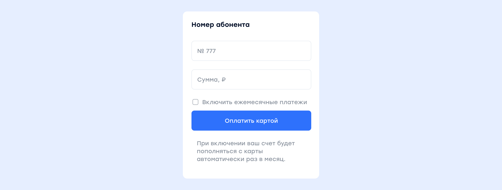
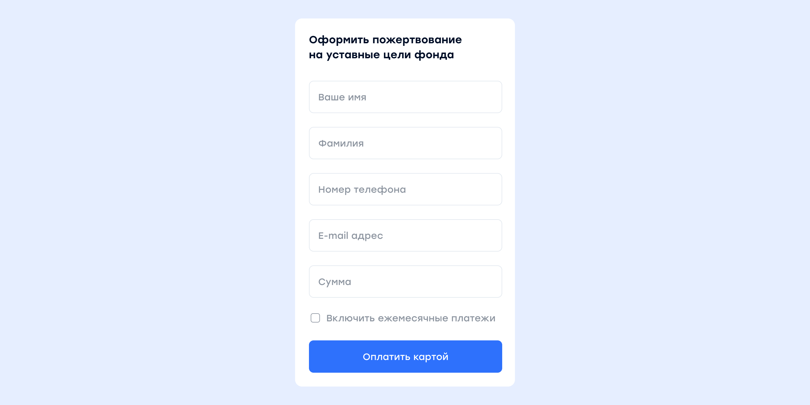
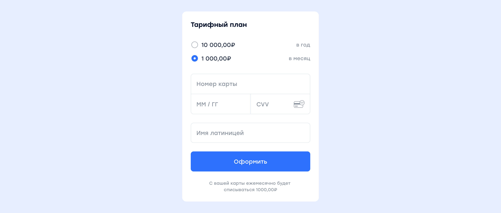

# Сценарии интеграции

Система предлагает различные варианты интеграции от очень простого до бесконечно функционального в зависимости от требований.

<aside class="notice">Интеграция без проверки платежей не рекомендуется. <br />Обязательно сверять сумму, номер заказа и идентификатор аккаунта плательщика.</aside>

## Платежная форма 


Если вам не требуется проверять платежи перед оплатой и фиксировать факт после оплаты:

* пропишите на свой сайт [скрипт установки виджета](mpf.md#установка-виджета);
* настройте в <a href="https://merchant.cloudpayments.ru/" target="_blank">личном кабинете</a> e-mail адрес для уведомлений о платежах.

## Регистрация платежей


Если вам необходимо регистрировать платежи в своей системе, но нет необходимости проверять перед оплатой, то ваши действия следующие:  

* пропишите на свой сайт [скрипт виджета](mpf.md#установка-виджета);
* настройте регистрацию платежей:

	* создайте скрипт обработки [Pay уведомления](notifications.md#pay), например,  **https://site.ru/webhooks/cloudpayments/pay**;
	* пропишите в обработчике логику регистрации платежей и ответ в JSON-формате;
	* включите в <a href="https://merchant.cloudpayments.ru/" target="_blank">личном кабинете</a> отправку Pay-уведомлений.

## Проверка и регистрация платежей


Если вам необходимо проверять и регистрировать платежи в своей системе, ваши действия следующие:

* пропишите на свой сайт скрипт установки виджета;
* настройте проверку платежей: 
	* создайте скрипт обработки [Check уведомления](notifications.md#check), например, **https://site.ru/webhooks/cloudpayments/check**;  
	* пропишите в обработчике логику проверки платежей и ответ в JSON-формате;  

* настройте регистрацию платежей:  
	* создайте скрипт обработки [Pay уведомления](notifications.md#pay), например, **https://site.ru/webhooks/cloudpayments/pay**;
	* пропишите в обработчике логику регистрации платежей и ответ в JSON-формате;

* включите в личном кабинете отправку Check и Pay-уведомлений.

## Автоплатежи для интернет-провайдеров


Платежное решение подходит для интернет-провайдеров, операторов связи и телекомов. Уведомления на проверку и регистрацию платежей могут быть настроены как в формате CloudPayments, так и в формате QIWI (ОСМП).


 


**Код формы:**

```js
    this.paySample3 = function () {
    var widget = new cp.CloudPayments();

    var userInfo = {};
    var auto = $('#recurrent-sample-3').is(':checked'); //проверка

    if (auto) { //включаем подписку

        var accountId = $('#account-sample-3').val();
        var date = new Date(); //текущая дата
        date.setMonth(date.getMonth() + 1); //следующий месяц
        date.setDate(date.getDate() - 1); //минус один день

        var recurrent = { interval: 'Month', period: 1, startDate: date }; //один раз в месяц начиная со следующего месяца за минусом одного дня
        
        userInfo.accountId = "accountId" //идентификатор плательщика (обязательно для создания подписки)
    }

    var amount = parseFloat($('#amount-sample-3').val());

    widget.start({ 
        publicTerminalId: 'test_api_00000000000000000000002', //id из личного кабинета
        description: 'Пополнение счета абонента ' + accountId, //назначение
        paymentSchema: "Single" // Одностадийная оплата
        amount: amount, //сумма
        currency: 'RUB', //валюта
        recurrent: recurrent
        userInfo: userInfo
    },
    function (options) { // success
        //действие при успешной оплате
    },
    function (reason, options) { // fail
        //действие при неуспешной оплате
    });
};

$('#checkout-sample-3').click(paySample3);

```

<aside class="notice">В примере используется библиотека jquery. </aside>

## Автоплатежи для благотворительных фондов


Платежное решение подходит для благотворительных фондов. Имя, фамилия, телефон, e-mail и любые другие данные с формы будут сохранены в виджете и переданы на ваш сервер через [Pay-уведомление](notifications.md#pay).

 

**Код формы:**

```js
    this.paySample4 = function () {
    var widget = new cp.CloudPayments();

    var userInfo = { //данные дарителя
        name: $('#name-sample-4').val(),
        lastName: $('#lastName-sample-4').val(),
        phone: $('#phone-sample-4').val(),
        accountId = $('#email-sample-4').val(); //идентификатор плательщика (обязательно для создания подписки)
    };
    
    var recurrent = {};
    var auto = $('#recurrent-sample-4').is(':checked'); //проверка

    if (auto) { //включаем подписку
        recurrent = { interval: 'Month', period: 1 } //один раз в месяц начиная со следующего месяца
    }
    var amount = parseFloat($('#amount-sample-4').val());

    widget.start({ 
        publicTerminalId: 'test_api_00000000000000000000002', //id из личного кабинета
        description: 'Пожертвование в фонд ...', //назначение
        amount: amount, //сумма
        currency: 'RUB', //валюта
        email: userInfo.accountId,
        userInfo: userInfo,
        recurrent: recurrent
    },
    function (options) { // success
        //действие при успешной оплате
    },
    function (reason, options) { // fail
        //действие при неуспешной оплате
    });
};

$('#checkout-sample-4').click(paySample4);
```

<aside class="notice">В примере используется библиотека jquery. </aside>

## Платежи по подписке

Если вам нужно брать с ваших покупателей плату на регулярной основе, по расписанию, сценарий может быть следующим:
  
* На вашем сайте необходима авторизация пользователей с доступом в личный кабинет.  
* Перед созданием плана подписки, проинформируйте пользователя о тарифном плане, периодичности платежей и предложите указать карточные данные.  

  
  
* В соответствии с вашим бизнес-процессом сделайте авторизацию на 1 рубль для проверки карты или оплату на сумму первого периода подписки.  
* Получите токен карты через любой метод оплаты по API или [Pay-уведомление](notifications.md#pay) и [создайте план рекуррентных платежей](api/17-sozdanie-podpiski-na-rekurrentnye-platezhi.md).   

<aside class="notice">Обязательным условием получения токена является передача идентификатора пользователя в параметре AccountId.</aside>
 
* Подпишитесь на [Fail-](notifications.md#fail) и [Recurrent](notifications.md#recurrent)-уведомления. После получения уведомления о неуспешном платеже проинформируйте пользователя, что ему необходимо проверить карту. При окончании срока подписки или отмене завершите предоставление услуг.  
* Сделайте раздел с историей платежей, которая включает в себя как минимум дату и сумму оплаты.

## Платежи в один клик

 Если вам нужно сохранять данные карт на стороне платежного шлюза для последующей оплаты в один клик без ввода карточных данных и без 3-D Secure, сценарий может быть следующим:   
 
* На вашем сайте необходима авторизация пользователей с доступом в личный кабинет.
* При первой оплате предложите пользователю привязать карту, чтобы не вводить реквизиты при каждом платеже.

   
 
 Если пользователь согласится, сохраните после оплаты в его профиле маску карты (тип и последние 4 цифры), а также токен. Параметры карты и токен система возвращает в [Pay](notifications.md#pay)-уведомлении и через API.   
 
 <br />
 <aside class="notice">Обязательным условием получения токена является передача идентификатора пользователя в параметре AccountId.</aside>
  
* При последующих оплатах предлагайте пользователю оплатить с ранее привязанной карты.  

   
 
  Если пользователь выбирает ранее использованную карту — вызывайте [метод оплаты по токену](api/04-oplata-po-tokenu-rekarring.md) через API.  
  
* Предоставьте пользователю возможность управлять своими картами.  

    
   
   Если пользователь не желает более платить с привязанной карты, удалите маску и токен из его профиля.  
   
* Сделайте раздел с историей платежей, которая включает в себя как минимум дату и сумму оплаты.
