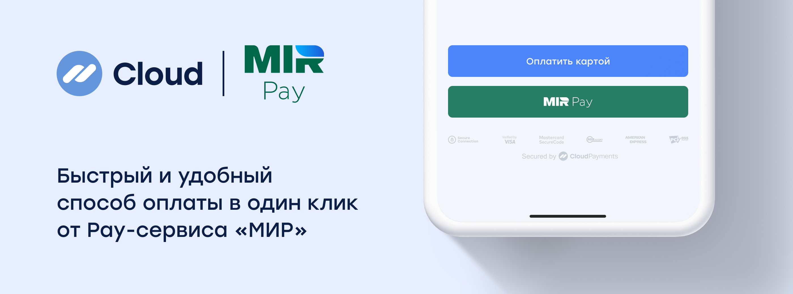
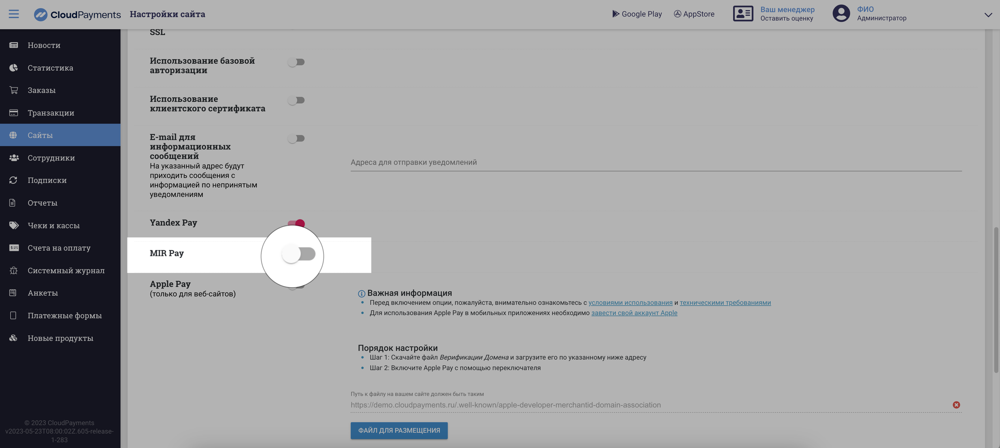

# MIR Pay

MIR Pay позволяет оплачивать покупки в одно касание картами платежной системы «МИР». Кнопка Pay-сервиса отображается на платёжной странице рядом с другими способами оплаты.

## Виды интеграций

CloudPayments предлагает подключение MIR Pay по упрощенной схеме на странице оплаты (с помощью платежного виджета) и через мобильный SDK. Дополнительно интегрироваться с сервисом платежной системы «МИР» не нужно.

В ближайшее время MIR Pay будет доступен для других видов интеграций: платежные блоки, заказы и платежные ссылки.

## Подключение MIR Pay

**Для включения кнопки MIR Pay в платежном виджете и мобильном SDK необходимо:**

Переключить «фича-тоггл» MIR Pay в Личном кабинете, в настройках сайта или написать в службу поддержки CloudPayments.
 

### Процесс оплаты с помощью MIR Pay

* Покупатель после нажатия кнопки «Оплатить» переходит на виджет CloudPayments, где может выбрать оплату по MIR Pay без ввода банковских реквизитов. 
* После оплаты покупатель видит сообщение об успешном платеже и автоматически возвращается обратно на сайт. Продавцу приходит уведомление о транзакции.
* Продавцу не нужно интегрироваться с сервисом платежной системы «МИР», все необходимое реализовано на стороне CloudPayments.
