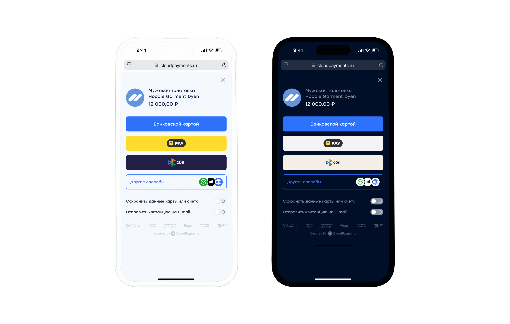

# Платежный виджет

Платежный виджет — всплывающая форма для ввода реквизитов карты и e-mail адреса плательщика. Виджет автоматически определяет тип платежной системы: Visa, MasterCard, Maestro или "МИР", а также банк-эмитент карты и показывает соответствующие логотипы. Форма оптимизирована для использования в любых браузерах и мобильных устройствах. Внутри виджета открывается iframe, который гарантирует безопасность передачи карточных данных и не требует от ТСП сертификации для использования.

Подробная <a href="https://widget.cloudpayments.ru/docs/widget.html" target="_blank">документация</a> для разработчиков.

Демо <a href="https://widget.cloudpayments.ru/app/demo" target="_blank">платежного конструктора</a>.

<aside class="warning">Контроль суммы при оплате необходимо осуществлять самостоятельно. Для проверки суммы можно использовать уведомления: <a href="notifications.md#check">Check</a> - для проверки суммы до оплаты, <a href="notifications.md#pay">Pay</a> - для проверки суммы после оплаты</aside>  

## Демо виджета

Демонстрация работы виджета [Widget](mpf.md)  представлена в нашем <a href="https://show.cloudpayments.ru/widget/" target="_blank"> демо-магазине</a>.  
Для тестирования можно использовать как [тестовые карточные данные](testing.md), так и реальные. Списания денежных средств не произойдет.

<iframe src="/slate-pages/demo_widget.html" width="96%" scrolling="no" height="685px" align="baseline"  hspace="2px" vspace="2px" frameborder="0" seamless></iframe>

## Мобильный виджет

Скрипт автоматически определяет устройство пользователя и запускает наиболее подходящий вариант виджета: обычный либо оптимизированный для мобильных устройств. Для удобства покупателей мобильная версия виджета занимает весь экран и предлагает провести оплату либо картой, либо одним из альтернативных методов оплаты.



## Установка виджета

Для установки виджета необходимо прописать на сайте скрипт в раздел **head**:

```shell
<script src="https://widget.cloudpayments.ru/bundles/cloudpayments.js"></script>
```

<aside class="warning">Используйте cloudpayments.js, чтобы оставаться совместимым с PCI, гарантируя, что платежные реквизиты отправляются напрямую в CloudPayments, не затрагивая ваш сервер. Всегда загружайте cloudpayments.js с https://widget.cloudpayments.ru, чтобы соответствовать требованиям. Не включайте скрипт в пакет и не размещайте его самостоятельно.</aside>  

Для появления платежной формы необходимо зарегистрировать функцию для вызова метода **start**:

```js
public start(intentParams: CreateIntentCommand): Promise&lt;WidgetResult&gt;
```

И прописать вызов функции на событие, например, нажатие кнопки «Оплатить»:

```js
$('#checkout').click(start);
```
<aside class="notice">В примере используется библиотека jquery.</aside>

Демонстрация работы виджета представлена в нашем <a href="https://show.cloudpayments.ru" target="_blank"> демо-магазине</a>.

Пример реализации запуска виджета без библиотеки jquery:

```js
document.querySelector('#checkout').onclick = start
```

```js

const widget = new cp.CloudPayments();
 
const launchWidget = () => {
  const intentParams = {
"publicTerminalId": "test_api_00000000000000000000002",
"paymentSchema": "Single",
"description": "Тестовая оплата",
"amount": 10000,
"currency": "RUB"
  };
 
  widget.oncomplete = (result) => {
    console.log(result);
  }
 
  widget.start(intentParams).then(function(widgetResult) {
    console.log('result', widgetResult);
  }).catch(function(error) {
    console.log('error', error);
  });
}
launchWidget()

```

Для тестирования можно использовать как [тестовые карточные данные](testing.md), так и реальные. Списания денежных средств не произойдет.

## Расширенный набор полей виджета

```js

const btn = document.getElementById("payButton")
 
const widget = new cp.CloudPayments();
 
const launchWidget = () => {
  const intentParams = {
    publicTerminalId: "test_api_00000000000000000000002", // идентификатор терминала
    description: "Basket of oranges", // описание списания
    paymentSchema: 'Dual', // схема
    currency: "RUB", // валюта
    culture: "ru-RU",
    amount: 1001, // сумма
    skin: "modern", //дизайн виджета (необязательно)
    autoClose: 3, //время в секундах до авто-закрытия виджета (необязательный)
    cryptogramMode: false, // признак режима работы виджета. Если указано true - вместо проведения оплаты будет сформирована криптограмма карточных данных
    externalId: "your_system_payment_identifier", // идентификатор платежа в вашей системе
    restrictedPaymentMethods: [ // список отключенных для данной оплаты методов
        'Sbp'
    ],
         
   appearance: {
        colors: {
          primaryButtonColor: "#1dfa05",
          primaryHoverButtonColor: "#da1ef7",
          primaryButtonTextColor: "#da1ef7",
          primaryButtonHoverTextColor: "#da1ef7",
          activeInputColor: "#da1ef7",
          inputBackground: "#da1ef7",
          inputColor: "#1dfa05",
          inputBorderColor: "#f20505",
          titleColor: "#da1ef7",
          textColor: "#1dfa05",
          errorColor: "#ee05fa",
          skeletonBackground: "#ee05fa",
          background: "#ffffff"
        },
        backdrop: {
          blur: "8",
          opacity: 0.5,
          background: "#6b7cd1"
        },
        components": {
          paymentForm: {
          fontSize: "16",
          labelFontSize: "16",
          activeLabelFontSize: "12"
    },
        paymentButton: {
         fontSize: "16",
         text: "Оплатить",
 
        borders: {
          radius: "80px"
        }
      },
 
     userInfo: {
        accountId: "your_system_user_id",
        firstName: "Test",
        lastName: "Test",
        middleName: "Test",
        fullName: "Test Test Test",
        birth: "2000-30-03",
        address: "д. 7",
        street: "ул. Тестовая",
        city: "г. Москва",
        country: "Россия",
        phone: "+71234567890",
        postCode: "119518",
        email: "user@email.com",
        customField: {
          name: "your_field_name",
          value: "your_field_value"
        }
    },
    payerServiceFee: 50, // комиссия, оплачиваемая пользователем
    recurrent: {
        period: 1, // частота списания
        interval: 'Day', // интервал списания
        amount: 500, // сумма
        startDate: "2030-04-15T00:00:00.0000000Z", // дата начала
        maxPeriods: 50, // количество списаний после которых рекуррент будет остановлен
        receipt: { // чек для рекуррента
            items: [ //товарные позиции
                {
                    label: 'Наименование товара 3', //наименование товара
                    price: 300.00, //цена
                    quantity: 3.00, //количество
                    amount: 900.00, //сумма
                    vat: 20, //ставка НДС
                    method: 0, // тег-1214 признак способа расчета - признак способа расчета
                    object: 0, // тег-1212 признак предмета расчета - признак предмета товара, работы, услуги, платежа, выплаты, иного предмета расчета
                }
            ],
            taxationSystem: 0, //система налогообложения; необязательный, если у вас одна система налогообложения
            email: 'user@example.com', //e-mail покупателя, если нужно отправить письмо с чеком
            phone: '', //телефон покупателя в любом формате, если нужно отправить сообщение со ссылкой на чек
            isBso: false, //чек является бланком строгой отчетности
            amounts: {
                electronic: 900.00, // Сумма оплаты электронными деньгами
                advancePayment: 0.00, // Сумма из предоплаты (зачетом аванса) (2 знака после точки)
                credit: 0.00, // Сумма постоплатой(в кредит) (2 знака после точки)
                provision: 0.00 // Сумма оплаты встречным предоставлением (сертификаты, др. мат.ценности) (2 знака после точки)
            }
        }
    },
 
    items: [{
            id: "your_system_item_unique_identifier_1", // уникальный идентификатор товара в вашей системе (или для данной оплаты)
            name: "Basket", // наименование товара
            count: 1, // количество
            price: 100, // стоимость
            // label?: string | null;
            // quantity?: number | null;
        },
        {
            id: "your_system_item_unique_identifier_2",
            name: "Orange",
            count: 9,
            price: 100,
        }
    ],
    receipt: {
        items: [ //товарные позиции
            {
                label: "Наименование товара 1", //наименование товара
                price: 100.00, //цена
                quantity: 1.00, //количество
                amount: 100.00, //сумма
                vat: 0, //ставка НДС
                method: 0, // тег-1214 признак способа расчета - признак способа расчета
                object: 0, // тег-1212 признак предмета расчета - признак предмета товара, работы, услуги, платежа, выплаты, иного предмета расчета
                measurementUnit: "шт" //единица измерения
            }, {
                label: "Наименование товара 2", //наименование товара
                price: 200.00, //цена
                quantity: 2.00, //количество
                amount: 300.00, //сумма со скидкой 25%
                vat: 10, //ставка НДС
                method: 0, // тег-1214 признак способа расчета - признак способа расчета
                object: 0, // тег-1212 признак предмета расчета - признак предмета товара, работы, услуги, платежа, выплаты, иного предмета расчета
                measurementUnit: "шт", //единица измерения
                excise: 0.01, // тег-1229 сумма акциза
                countryOriginCode: "156", // тег-1230 цифровой код страны происхождения товара в соответствии с Общероссийским классификатором стран мира 3 симв.
                customsDeclarationNumber: "54180656/1345865/3435625/23", // тег-1231 регистрационный номер таможенной декларации 32 симв.
                ProductCodeData: //данные маркировки товара
                {
                    CodeProductNomenclature: "3031303239303030303033343....a78495a4f6672754744773d3d" //HEX представление штрих/бар кода маркировки целиком (Только для касс Микропэй)
                }
            }, {
                label: "Наименование товара 3", //наименование товара
                price: 300.00, //цена
                quantity: 3.00, //количество
                amount: 900.00, //сумма
                vat: 20, //ставка НДС
                method: 0, // тег-1214 признак способа расчета - признак способа расчета
                object: 0, // тег-1212 признак предмета расчета - признак предмета товара, работы, услуги, платежа, выплаты, иного предмета расчета
                measurementUnit: "шт", //единица измерения
                AgentSign: 6, //признак агента, тег ОФД 1057, 1222
                AgentData: { //данные агента, тег офд 1223
                    AgentOperationName: null, // наименование операции банковского платежного агента или банковского платежного субагента, тег ОФД 1044
                    PaymentAgentPhone: null, // телефон платежного агента, тег ОФД 1073
                    PaymentReceiverOperatorPhone: null, // телефон оператора по приему платежей, тег ОФД 1074
                    TransferOperatorPhone: null, // телефон оператора перевода, тег ОФД 1075
                    TransferOperatorName: null, // наименование оператора перевода, тег ОФД 1026
                    TransferOperatorAddress: null, // адрес оператора перевода, тег ОФД 1005
                    TransferOperatorInn: null // ИНН оператора перевода, тег ОФД 1016
                },
                PurveyorData: { //данные поставщика платежного агента,  тег ОФД 1224
                    Phone: "+71234567890", // телефон поставщика, тег ОД 1171
                    Name: "ООО Ромашка", // наименование поставщика, тег ОФД 1225
                    Inn: "1234567890" // ИНН поставщика, тег ОФД 1226
                }
            }
        ],
        calculationPlace: "www.my.ru", //место осуществления расчёта, по умолчанию берется значение из кассы
        taxationSystem: 0, //система налогообложения; необязательный, если у вас одна система налогообложения
        email: "user@example.com", //e-mail покупателя, если нужно отправить письмо с чеком
        phone: "", //телефон покупателя в любом формате, если нужно отправить сообщение со ссылкой на чек
        customerInfo: "", // тег-1227 Покупатель - наименование организации или фамилия, имя, отчество (при наличии), серия и номер паспорта покупателя (клиента)
        customerInn: "7708806063", // тег-1228 ИНН покупателя
        isBso: false, //чек является бланком строгой отчётности
        AgentSign: null, //признак агента, тег ОФД 1057
        amounts: {
            electronic: 1300.00, // Сумма оплаты электронными деньгами
            advancePayment: 0.00, // Сумма из предоплаты (зачетом аванса) (2 знака после точки)
            credit: 0.00, // Сумма постоплатой(в кредит) (2 знака после точки)
            provision: 0.00 // Сумма оплаты встречным предоставлением (сертификаты, др. мат.ценности) (2 знака после точки)
        }
    },
    metadata: {
        referrerId: "some_referrer_123"
    },
    successRedirectUrl: "<https://example.com>",
    failRedirectUrl: "<https://failexample.com>",
    escrow: {
        startAccumulation: true,
        accumulationId: null,
        escrowType: "OneToN"
    },
    retryPayment: false,
    receiptEmail: "user@example.com",
    tokenize: true,
    emailBehavior: "Required",
  };
 
  widget.oncomplete = (result) => {
      console.log(result);
  }
 
  widget.start(intentParams).then(function(widgetResult) {
      console.log('result', widgetResult);
  }).catch(function(error) {
      console.log('error', error);
  });
}
 
btn.addEventListener('click', launchWidget)
```

## Параметры

<aside class="notice">
По требованию НСПК, для ТСП, предоставляющих телекоммуникационные услуги (MCC 4814 Telecommunication Services), обязательна передача номера телефона плательщика. При отсутствии номера телефона в запросе, банки-эквайеры будут отклонять проводимые операции.
<br />
<br />
Номер телефона необходимо передавать в объекте Payer в параметре Phone. 
<br />
Формат передачи: только цифры, без разделителей “( )“, “-“ .
<br />
Пример передачи: “+71234567890“
</aside>

|Параметр | Тип | Описание | Обязательность| Значение по умолчанию|
|--- | --- | --- | ---| ---|
|publicTerminalId | string | Публичный ID терминала | Обязателен| 
|amount | float | Cумма платежа. Должно быть > 0<br />Пример: 2; 2.5; 2.57 | Обязателен|
|currency | string<br />enum | Валюта платежа ([см. справочник](handbook.md#список-валют))| Обязателен|
|culture | string | Язык виджета (По умолчанию `ru-RU`) ([см. справочник](handbook.md#языки)) | Необязателен| ru-RU|
|description | string | Описание назначения оплаты в произвольном формате | Необязателен|
|externalId | string | Идентификатор заказа в вашей системе.<br />Приходит в [уведомлениях](notifications.md)<br />(ранее `invoiceId`) | Необязателен|
|paymentSchema | string<br />enum | Схема обработки транзакций (ранее `charge`/`auth`):<br />`Single` — одностадийная оплата.<br />`Dual` — двухстадийная оплата. | Обязателен|
|receiptEmail | string | Email для отправки квитанции и чека. | Необязателен|
|restrictedPaymentMethods | string[]<br />enum | Cписок отключенных для данной оплаты методов<br />Доступные значения: `Card`, `TcsInstallment`, `Sbp`, `TinkoffPay`, `MirPay`, `Dolyame`, `ForeignCard`, `SberPay` | Необязателен|
|tokenize | bool | Сохранение карты для последующего использования.Приходит в [уведомлениях](notifications.md) и позволяет оплачивать по [токену](api/04-oplata-po-tokenu-rekarring.md) <br />Значение параметра будет учитываться только тогда, когда в настройках сайта установлено значение "Спрашивать пользователя"  <br />Для сохранения карты, необходимо передать "accountId" в "userInfo" <br />| Необязателен| По умолчанию false. Для корректной работы параметра, необходимо также  выставить настройки в разделе разделе "Сайты" в личном кабинете мерчанта|
|recurrent | object | Настройки для рекуррентных платежей ([см. справочник](#параметры-рекуррентные-платежи)) Для создания рекуррентных платежей, необходимо передать "accountId" в "userInfo"| Необязателен|
|escrow | object | Настройки для безопасной сделки ([см. справочник](#параметры-настройки-безопасной-сделки)) | Необязателен|
|items | object[] | Список товаров ([см. справочник](#параметры-список-товаров))| Необязателен|
|receipt | object | Объект чека. Используется при подключении CloudKassir. Для более подробной информации [см. cправочник](online-kassa.md#формат-передачи-данных-для-онлайн-чека) | Необязателен|
|userInfo | object | Информация о плательщике ([см. справочник](#параметры-данные-о-плательщике)) | Необязателен|
|metadata | object | Дополнительные метаданные в формате JSON которые будут связаны с транзакцией. (ранее `data`)<br />Приходит в [уведомлениях](notifications.md) | Необязателен|
|successRedirectUrl | string | Адрес страницы для редиректа при успешной оплате<br />Если параметр не задан, при нажатии на кнопку "вернуться в магазин" после успешной оплаты, закрывается iframe и пользователь остается на странице, на которой был поднят виджет | Необязателен|
|failRedirectUrl | string | Адрес страницы для редиректа при неуспешной оплате<br />Если параметр не задан, при нажатии на кнопку "вернуться в магазин" после неуспешной оплаты, закрывается iframe и пользователь остается на странице, на которой был поднят виджет. Параметр связан с "retryPayment" на виджете отображается ИЛИ кнопка повторной оплаты или кнопка редиректа.  | Необязателен|
|emailBehavior | string | Email пользователя:<br />`Required`: Обязателен.<br />`Hidden`: Скрыт.<br />`Optional`: Необязателен.<br />Отображается изначально в отключенном состоянии, клиент может включить для получения квитанции (Значение по умолчанию) | Необязателен| Optional|
|retryPayment | bool | Появление кнопки «Повторить платеж» при неудачном платеже (По умолчанию `true`)<br />Если передать `false`, то после неудачной попытки оплаты клиенту сразу будет предложено вернуться на сайт, следующую попытку он сможет совершить только в новой оплате | Необязателен| true
|autoClose | int | Автоматическое закрытие виджета после успешной оплаты через указанное количество секунд. Значение в промежутке от 3 до 10 включительно<br />Если параметр не передан, виджет скрывается по действиям пользователя<br /> | Необязателен|
|skin | string[]<br />enum | Вид виджета<br />Доступные значения:<br />`classic` светлая тема (Значение по умолчанию)<br />`modern`: темная тема <br />Логика работы Темы и Кастомизации отдельных элементов виджета работает поверх темы. Если никакая тема не указана, используется по умолчанию светлая<br /> | Необязателен| classic|
|components|object|Параметры цветовой кастомизации компонентов ( текстов, инпутов) |Необязателен|
|appearance| object| Параметры цветовой кастомизации элементов | Необязателен|

### Рекуррентные платежи

Можно реализовать списания рекуррентных платежей с помощью механизмов CloudPayments: мы сами будем отвечать за периодичность и попытки оплаты. Для этого необходимо дополнительно передавать следующие параметры в рамках объекта `recurrent`:

|Параметр | Тип | Описание | Обязательность|
|--- | --- | --- | ---|
|period | int | Частота использования интервала. Должен быть больше 0 | Обязателен|
|interval | string<br />enum | Интервал. Доступные значения:<br />`Week` (неделя),<br />`Month` (месяц),<br />`Day` (день) | Обязателен|
|maxPeriods | int | Максимальное количество платежей в подписке. Если задаете количество, проверьте, чтобы оно было больше 0 | Необязателен|
|amount | decimal | Сумма регулярного платежа. Для целей когда инитный и регулярный платёж отличаются. Сумма должна содержать не более двух знаков после запятой. Если указываете другую сумму, проверьте, чтобы она была больше 0 | Необязателен|
|startDate | dateTime | Дата и время первого регулярного платежа. Для целей когда дата первого платежа должна быть не через указанный интервал. Если указываете другую дату, то она должна стоять в будущем времени | Необязателен|
|receipt | string | Данные для формирования онлайн-чека в регулярных платежах | Необязателен|

### Настройки безопасной сделки

Для настройки [безопасной сделки](escrow.md) необходимо дополнительно передавать следующие параметры в рамках объекта `escrow`:

|Параметр | Тип | Описание | Обязательность|
|--- | --- | --- | ---|
|startAccumulation | bool | Флаг начала накопления | Необязателен|
|accumulationId | string | ID накопления на стороне банка | Необязателен|
|escrowType | String | Тип счета. Доступные значения: `NToOne`, `OneToN`, `NToN` | Необязателен|

### Данные о плательщике

Для передачи информации о плательщике необходимо дополнительно передавать следующие параметры в рамках объекта `userInfo`:

|Параметр | Тип | Описание | Обязательность|
|--- | --- | --- | ---|
|firstName | string | Имя | Необязателен|
|lastName | string | Фамилия | Необязателен|
|middleName | string | Отчество | Необязателен|
|fullName | string | Полное имя | Необязателен|
|birth | string | Дата рождения | Необязателен|
|address | string | Адрес | Необязателен|
|street | string | Улица | Необязателен|
|city | string | Город | Необязателен|
|country | string | Страна | Необязателен|
|phone | string | Номер телефона. Пример: +7xxxxxxxxxx | Необязателен|
|postCode | string | Индекс | Необязателен|
|accountId | string | Внешний идентификатор плательщика в системе мерчанта (Необходим для создания рекуррентого платежа). Должен быть меньше 255 символов | Необязателен|
|email | string | Email плательщика | Необязателен|
|customField | object | Кастомное поле | Необязателен|
|customField.name | string | Название кастомного поля | Обязателен|
|customField.value | string | Значение кастомного поля | Необязателен|

### Список товаров

В случае, когда необходимо передавать одни и те же товары в разных процессах (например, при формировании чека) необходимо дополнительно передавать следующие параметры в рамках объекта `items`:

|Параметр | Тип | Описание | Обязательность|
|--- | --- | --- | ---|
|id | string | ID товара | Обязателен|
|name | string | Название товара | Обязателен|
|count | decimal | Количество позиций товара | Обязателен|
|price | decimal | Цена одной позиции товара | Обязателен|

В случае, если список товаров передан, то система будет искать аналогичный товар в списке товаров чека. Поиск осуществляется по значению параметра `id`, поэтому позиция товара в чеке должна иметь аналогичный `id`, как и в списке товаров.

## События (коллбэки)

Коллбэки – события, которые срабатывают при определенных условиях. Условия формирования событий (коллбэков):

**oncomplete**

Получение финального статуса по транзакции, так же после возврата к списку методов, если была неуспешная оплата

Формат ответа у данного коллбэка зависит от успеха платежа и совпадает с форматом **widgetResult** в случае успешной или неуспешной оплаты соответственно

**function(widgetResult)**

Завершение работы виджета. **widgetResult** – объект результата

Возможные значения `type`:

– `cancel` — закрытие без оплаты<br />
– `payment` — оплата<br />
– `installment` — рассрочка<br />
– `error` — ошибка при оплате

Возможные значения `status`:

– `success` — успех<br />
– `fail` — неудача при оплате<br />
– `appointment` — авторизация по рассрочке<br />
– `reject` — отклоненная по рассрочке<br />
– `cancel` — отмененная транзакция

**Пример без оплаты (type = cancel):**

```js
{
    "type": "cancel"
}
```

**Пример для успеха (status = success):**

```js
{
   "type":"payment",
   "data":{
      "transactionId":3059300327
   },
   "status":"success"
}
```

**Пример для отклоненной транзакции (status = fail):**

```js
{
   "type":"error",
   "data":{
      "transactionId":3192600857,
      "ReasonCode":5206
   },
   "message":"3-D Secure авторизация не пройдена",
   "status":"fail"
}
```
