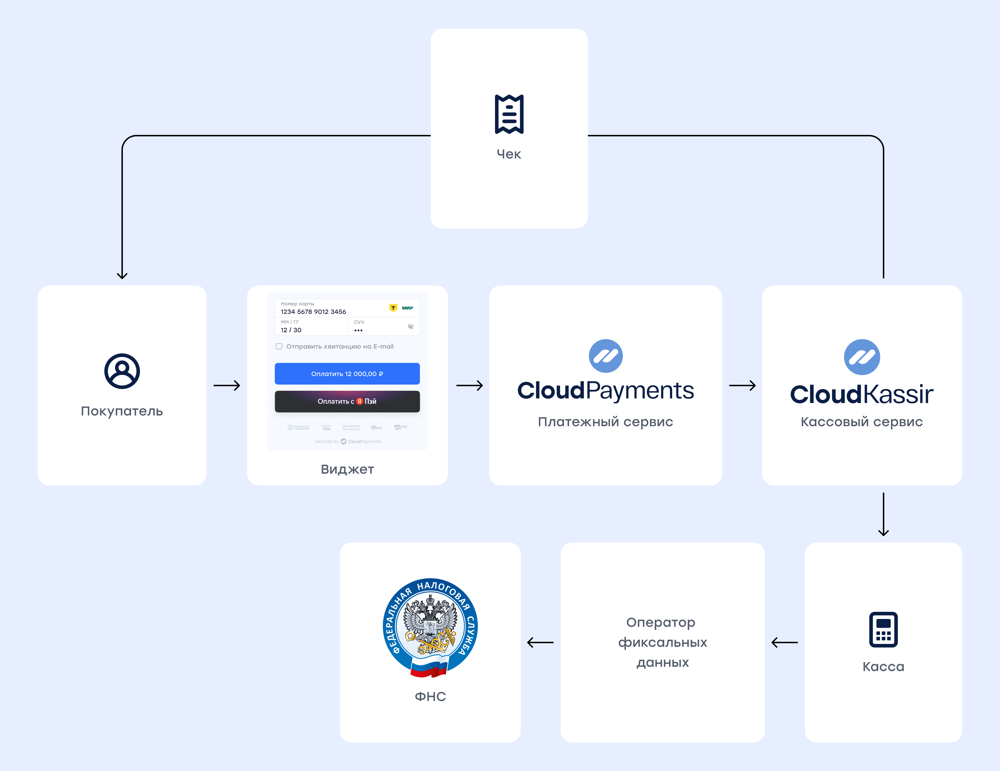
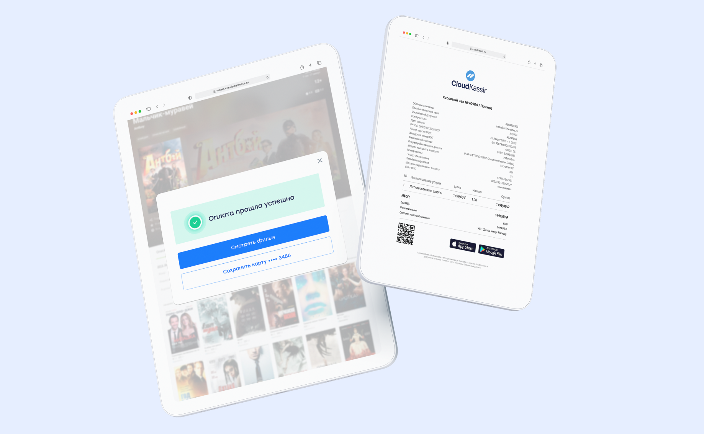

# Онлайн-касса для интернет-расчетов

## 54-ФЗ

Закон 54-ФЗ "О применении контрольно-кассовой техники" с изменениями от 03.07.2016 предписывает интернет-сервисам при осуществлении расчетов с использованием электронного средства платежа (в т.ч. банковской картой) использовать контрольно-кассовую технику (ККТ) и отправлять покупателю электронный чек в момент расчета.

## Основные положения закона

* Необходимо использовать кассу нового образца с установленным фискальным накопителем (ФН).
* Необходимо заключить договор с [оператором фискальных данных](handbook.md#операторы-фискальных-данных) (ОФД) для передачи данных с ККТ в режиме онлайн в ФНС.
* Необходимо указывать в чеке все товарные позиции: наименование, цена, количество, сумма, ставка НДС.
* Необходимо подключить кассу к интернету.
* Необходимо выдавать чек покупателю непосредственно в момент расчета: для интернет-платежей с использованием банковской карты отправлять чек на e-mail или телефон.
* Необходимо менять ФН  в двух случаях:  
	* по истечении его срока действия;  
	* при заполнении памяти до истечения срока действия;  
		и хранить  его в  течение 5-ти лет.  
* Нет необходимости заключать договор с ЦТО на обслуживание.
* Нет необходимости предъявлять кассу инспектору ФНС, все регистрационные действия можно выполнить дистанционно в личном кабинете налогоплательщика на сайте ФНС.

## Онлайн-фискализация

Компания CloudPayments предлагает своим партнерам облачное решение "под ключ" для онлайн-фискализации интернет-платежей, и в рамках соблюдения закона 54-ФЗ для любого бизнеса вы получите:

* выделенную онлайн-кассу, зарегистрированную в ФНС на вашу компанию;
* фискальный накопитель;
* подключение к оператору фискальных данных;
* автоматическое формирование чеков прихода и возврата в момент проведения расчета;
* полный отчет по операциям в личном кабинете.

Касса будет находиться в дата-центре 24/7, с подключением к интернету и питанию, работать круглосуточно и без перебоев. Наши сотрудники будут следить за ее техническим состоянием и своевременно менять фискальные накопители, а специальное программное обеспечение — корректировать ошибки, открывать и закрывать смену по расписанию, в "облаке" ставить чеки в очередь при большой нагрузке и гарантированно отправлять покупателям.



## Онлайн-касса

Мы используем кассы MicroPay-ФАС и MicroPay-ФС с подключением к любому [оператору фискальных данных](handbook.md#операторы-фискальных-данных).  



## Демонстрация технологии

<div  class="ck-demo">
<p> Пример оплаты по карте с автоматическим формированием чека и отправкой на электронный адрес или телефон. </p>
<iframe src="/slate-pages/cash_register_demo.html" width="100%" height="800px" align="baseline"  hspace="2px" vspace="2px" frameborder="1" seamless></iframe>
</div>

<div class="ck-demo-link">
<a href="/slate-pages/cash_register_demo.html">Пример</a>
<p>оплаты по карте с автоматическим формированием чека и отправкой на электронный адрес или телефон.</p>
</div>

### Стоимость

Стоимость услуг по онлайн-фискализации и сопровождению  можно узнать на сайте сервиса <a href="https://cloudkassir.ru" target="_blank">CloudKassir</a> и/или уточнить у менеджера.

## Порядок подключения

Для подключения услуги онлайн-фискализации необходимо:

* подключиться к сервису онлайн фискализации CloudKassir;
* получить квалифицированную электронную подпись для работы с сайтом ФНС;
* зарегистрироваться в личном кабинете налоговой службы:
    — для юридических лиц
    — для индивидуальных предпринимателей;
* заключить договор на онлайн-фискализацию с CloudKassir.

После подписания договора и оплаты счета вам будут предоставлены номер ККТ и ФН для регистрации в ФНС.

## Формат передачи данных для онлайн-чека

В данном разделе описаны параметры объекта **receipt**, который передается в рамках вызова виджета или платежного конструктора и отвечает за формирование чека.

Описание параметров для формирования объекта **СustomerReceipt**  в рамках вызова API CloudKassir смотрите в документации сервиса <a href="https://developers.cloudkassir.ru/#customerreceipt" target="_blank">CloudKassir</a>.

Данные для чека в рамках вызова виджета или платежного конструктора необходимо передавать в формате json по примеру ниже:

```js
var receipt = {
        Items: [ 
            {
                label: "Пластырь", // - обязательное поле
                price: 500, // цена одного товара - обязательное поле
                quantity: 1, // количество товара - обязательное поле
                amount: 500, // Сумма товара (price x quantity) - обязательное поле
                vat: 20, // Ставка НДС - обязательное поле,
            },
            {
                label: "Доставка", //, обязательное поле
                price: 500, // цена одного товара, обязательное поле
                quantity: 1, // количество товара, обязательное поле
                amount: 500, // сумма товара (price x quantity), обязательное поле
                vat : 20, // ставка НДС, обязательное поле
            }
        ],
        amounts : {
            electronic: 1000 // Сумма оплаты электронными деньгами
        }
    };
    
    const intentParams = {
      publicTerminalId: "test_api_00000000000000000000002", // идентификатор терминала
      description: "Basket of oranges", // описание списания
      paymentSchema: 'Single', // схема
      currency: "RUB", // валюта
      amount: 1000, // сумма
      receipt: receipt
    }

widget.start(intentParams).then(function(widgetResult) {
    console.log('result', widgetResult);
}).catch(function(error) {
    console.log('error', error);
});
```

**Пример использования [списка товаров](mpf.md#список-товаров)**:

```js
var receipt = {
        Items: [ 
            {
                id: "some_id_1", // id для поиска товара в списке товаров
                // label: "Пластырь", // - не передаём, так как берём из списка товаров
                // price: 500, // не передаём, так как берём из списка товаров
                // quantity: 1, // не передаём, так как берём из списка товаров
                amount: 500, // Сумма товара (items.price x items.count) - обязательное поле
                vat: 20, // Ставка НДС - обязательное поле,
            },
            {
                id: "some_id_2", // id для поиска товара в списке товаров
                // label: "Доставка", //, не передаём, так как берём из списка товаров
                // price: 500, // не передаём, так как берём из списка товаров
                // quantity: 1, // не передаём, так как берём из списка товаров
                amount: 500, // сумма товара (items.price x items.count) - обязательное поле
                vat : 20, // ставка НДС, обязательное поле
            }
        ],
        amounts : {
            electronic: 1000 // Сумма оплаты электронными деньгами
        }
    };

var items = [
              {
                id: "some_id_1",
                count: 1.0,
                name: "Пластырь",
                price: 500,
              },
              {
                id: "some_id_2",
                count: 1.0,
                name: "Доставка",
                price: 500,
              },
            ],
    
    const intentParams = {
      publicTerminalId: "test_api_00000000000000000000002", // идентификатор терминала
      description: "Basket of oranges", // описание списания
      paymentSchema: 'Single', // схема
      currency: "RUB", // валюта
      amount: 1000, // сумма
      receipt: receipt,
      items: items
    }

widget.start(intentParams).then(function(widgetResult) {
    console.log('result', widgetResult);
}).catch(function(error) {
    console.log('error', error);
});
```


## Условия успешного создания чека

* В чеке есть хотя бы одна позиция;
* Во всех позициях указано наименование;
* Цена и сумма позиции не отрицательная;
* Общая сумма всех позиций больше нуля;
* Входная строка наименования товара длиной не более 128 символов, более длинные строки будут обрезаны;
* Указанная система налогообложения должна совпадать с одним из вариантов, зарегистрированных в ККТ;
* Числовые значения переданы с точностью не более двух знаков после точки;
* Передан ИНН, если он требуется в документации.

Данные для онлайн-чека можно передавать в [параметры виджета](mpf.md#параметры), при [оплате по криптограмме](api/02-oplata-po-kriptogramme.md) или [токену](api/04-oplata-po-tokenu-rekarring.md), при [подтверждении оплаты](api/05-podtverzhdenie-oplaty.md), при [проведении возврата](api/07-vozvrat-deneg.md), а также через специальный <a href="https://developers.cloudkassir.ru/#api-kassy" target="_blank">API кассы</a>.


## Отправка покупателю онлайн-чека

На выбор покупателя кассовый чек необходимо отправить в письме на e-mail адрес или в СМС, Viber, WhatsApp, Telegram сообщении на номер телефона. Чек может быть отправлен системой CloudPayments автоматически, при условии передачи e-mail адреса или номера телефона покупателя, или же вы самостоятельно можете отправлять чек — все необходимые реквизиты система передает в уведомлении <a href="https://developers.cloudkassir.ru/#receipt" target="_blank">Receipt</a>.

## Момент отправки чека

Чек должен быть отправлен покупателю в момент расчета. Для [одностадийных платежей](general-information.md#схемы-проведения-платежа) чек формируется сразу же после прохождения оплаты, для [двухстадийных](general-information.md#схемы-проведения-платежа) — при подтверждении операции.

Формирование и отправка чека происходит после обновления статуса транзакции на “Завершена“ и выполняются процессы асинхронно. Для чего может потребоваться некоторое время.

## Тестирование онлайн-чека

При работе в тестовом режиме кассовые чеки будут формироваться в демонстрационной ККТ с отладочным фискальным накопителем. Вы можете передать [данные для онлайн-чека](#формат-передачи-данных-для-онлайн-чека) при оплате в тестовом режиме и проверить работу онлайн-кассы. 


<br />
<br />
