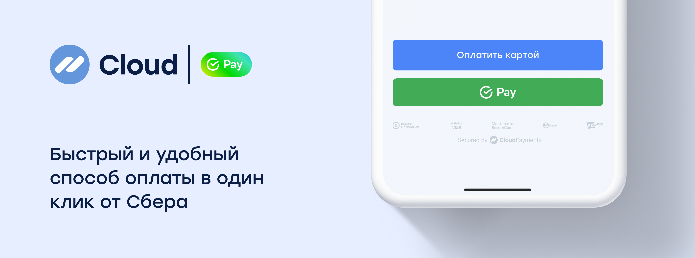

# SberPay



CloudPayments предлагает метод оплаты в один клик через SberPay.  Покупатель может выбрать любой счет для списания в приложении Сбера, а также копить баллы «Спасибо» для последующих покупок.

## Получение ссылки для оплаты

### Описание
Метод для проведения оплаты по SberPay. <br />
При оплате с мобильного устройства в ответе вернётся параметр `QrUrl` с
URL-адресом для перенаправления клиента. Для проведения платежа клиента надо перенаправить на полученный URL-адрес.<br />
При оплате с десктопа на номер телефона, который указан в параметре запроса `Phone`, будет отправлен push либо SMS-сообщение со ссылкой на оплату. 


Авторизация <a href="https://en.wikipedia.org/wiki/Basic_access_authentication" target="_blank">HTTP Basic Auth</a> для данного метода не требуется. Вместо неё используется параметр идентификатора терминала `PublicId` в теле запроса.

### Адрес метода
https://api.cloudpayments.ru/payments/qr/sberpay/link

### Параметры запроса

Параметр | Формат | Применение | Описание
--------- | ------- | ----------- | ----------- 
PublicId |	String |	Обязательный |	Идентификатор сайта, который находится в ЛК
Amount | Decimal | Обязательный| Cумма платежа в рублях, разделитель точка. Количество не нулевых знаков после точки – 2
Currency | String | Обязательный| Валюта: RUB (см. [справочник](handbook.md#список-валют))
Description | String | Необязательный | Назначение платежа в свободной форме
AccountId | String | Необязательный | Идентификатор пользователя, используется для создания подписки и получения токена
Email | String | Необязательный | E-mail плательщика, на который будет отправлена квитанция об оплате
JsonData | Json | Необязательный | Любые другие данные, которые будут связаны с транзакцией, в том числе [инструкции](api/17-sozdanie-podpiski-na-rekurrentnye-platezhi.md) для создания подписки или формирования [онлайн-чека](online-kassa.md#формат-передачи-данных-для-онлайн-чека) должны обёртываться в объект `cloudpayments`. Мы зарезервировали названия следующих параметров и отображаем их содержимое в реестре операций, выгружаемом в Личном Кабинете: `name`, `firstName`, `middleName`, `lastName`, `nick`, `phone`, `address`, `comment`, `birthDate`
InvoiceId | String | Необязательный | Идентификатор/номер счета.<br /><br />Приходит в Check-уведомлении и может использоваться для сверки номера заказа
Scheme | Enum String | Обязательный | Схема проведения платежа (см. [Виды операций](handbook.md#типы-операций)). <br />Возможные значения: `charge` - одностадийная оплата; `auth` - двухстадийная оплата
SuccessRedirectUrl | String | Необязательный |Url для перенаправления клиента после успешной оплаты. <br />После проведения платежа, клиент будет перенаправлен на указанный адрес из мобильного приложения Банка. 
IpAddress | String | Необязательный | IP-адрес плательщика
Os | String | Обязательный | Операционная система устройства плательщика. <br />Пример значения: `Android`, `iOS`, `Windows`
Webview | Bool | Обязательный | Признак открытия браузера в режиме webview. <br />Возможные значения: `true` - для оплат через webview `false` - для оплат без webview
Device | String | Обязательный | Признак устройства плательщика. <br />Возможные значения: <br />`MobileApp` - вызов оплаты из мобильного приложения <br />`DesktopWeb` - вызов оплаты из браузера с десктопа <br />`Mobile` - вызов из браузера с мобильного устройства
Phone | String | Необязательный | Номер телефона плательщика. <br />Пример значения: `+79001234567` <br />Обязательное значение для оплаты из браузера с десктопа 
Browser | String | Обязательный | Название браузера клиента на основании userAgent браузера. <br />Пример значения: `Chrome`, `Firefox`, `MIUI Browser`, `Opera`

В ответ сервер возвращает JSON с тремя составляющими:

- поле **success** — результат запроса;
- поле **message** — описание ошибки;
- объект **model** — расширенная информация.

Возможные варианты ответа:

1. Некорректно сформирован запрос:
  - **success** — false
  - **message** — описание ошибки
2. Транзакция отклонена:
  - **success** — false
  - **model** — информация о транзакции и код ошибки
3. Транзакция принята:
  - **success** — true
  - **model** — информация о транзакции

<aside class="notice">Результат запроса (поле Success) не отражает статус транзакции, а лишь свидетельствует об успешности/неуспешности запроса API. Статус транзакции отражен в дополнительном поле Status, также его можно узнать в результате получения <a href="notifications.md">уведомлений</a>. Интерпретацию статусов транзакции смотрите в <a href="handbook.md#статусы-операций">справочнике</a>.</aside>

### Пример запроса

```json
{
    "PublicId": "test_api_00000000000000000000002",
    "Os" : "Windows 7 home",
	"Webview" : true,
	"Browser" : "Microsoft Edge 24.101",
    "Amount": 1000,
    "Currency": "RUB",
    "Description": "Оплата по SberPay",
    "AccountId": "email@email.com",
    "Email": "email@email.com",
    "InvoiceId": "order_no4009",
    "Scheme": "charge",
    "Device": "DesktopWeb",
    "Phone": "79001234567",
    "SuccessRedirectUrl": "https://cp.ru",
}
```

### Пример ответа

```json 
{
    "Model": {
        "QrUrl": "sberpay://invoicing/v2?bankInvoiceId=5628ecb3ef514a48abed24e16f818f03&operationType=Web2App", // будет содержать url-адрес для редиректа
        "QrImage": null,                
        "TransactionId": 11122233344, // id транзакции CloudPayments
        "Amount": 10
    },
    "Success": true,
    "Message": null
}
```
