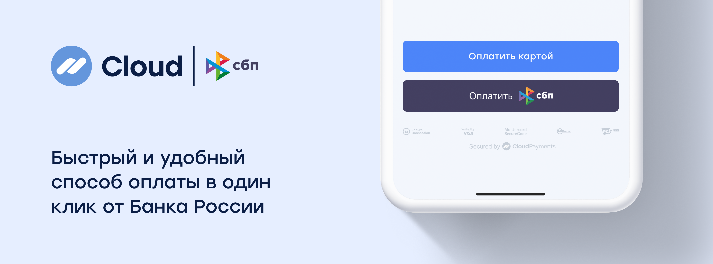

# СБП



CloudPayments предлагает метод оплаты в один клик через СБП. Покупатель может выбрать любой банк для списания через Систему
Быстрых Платежей.

## Получение ссылки для оплаты

### Описание
Метод для получения платёжной ссылки для перенаправления клиента в мобильное приложение банка. В ответе вернётся параметр `QrUrl` с
URL-адресом для перенаправления клиента.

Для проведения платежа, клиента надо перенаправить на полученный URL-адрес.
### Адрес метода
https://api.cloudpayments.ru/payments/qr/sbp/link

### Параметры запроса

Параметр | Формат | Применение | Описание
--------- | ------- | ----------- | ----------- 
PublicId |	String |	Обязательный |	Идентификатор сайта, который находится в ЛК
Amount | Decimal | Обязательный| Cумма платежа в рублях, разделитель точка. Количество не нулевых знаков после точки – 2
Currency | String | Обязательный| Валюта: RUB (см. [справочник](handbook.md#список-валют))
Description | String | Необязательный | Назначение платежа в свободной форме
AccountId | String | Необязательный | Идентификатор пользователя, используется для создания подписки и получения токена
Email | String | Необязательный | E-mail плательщика, на который будет отправлена квитанция об оплате
JsonData | Json | Необязательный | Любые другие данные, которые будут связаны с транзакцией, в том числе [инструкции](api/17-sozdanie-podpiski-na-rekurrentnye-platezhi.md) для создания подписки или формирования [онлайн-чека](online-kassa.md#формат-передачи-данных-для-онлайн-чека) должны обёртываться в объект `cloudpayments`. Мы зарезервировали названия следующих параметров и отображаем их содержимое в реестре операций, выгружаемом в Личном Кабинете: `name`, `firstName`, `middleName`, `lastName`, `nick`, `phone`, `address`, `comment`, `birthDate`
InvoiceId | String | Необязательный | Идентификатор/номер счета.<br /><br />Приходит в Check-уведомлении и может использоваться для сверки номера заказа
Scheme | Enum String | Обязательный | Схема проведения платежа (см. [Виды операций](handbook.md#типы-операций)). <br />Возможные значения: `charge` - одностадийная оплата
SuccessRedirectUrl | String | Необязательный | Url для перенаправления клиента после успешной оплаты. После проведения платежа, клиент будет перенаправлен на указанный адрес из мобильного приложения Банка.<br />Значение должно содержать не более 1024 символов, быть в кодировке ASCII и соответствовать формату спецификации RFC-3986. 
IpAddress | String | Необязательный | IP-адрес плательщика
Os | String | Необязательный | Операционная система устройства плательщика. <br />Пример значения: `Android`, `iOS`, `Windows`
Webview | Bool | Необязательный | Признак открытия браузера в режиме webview. <br />Возможные значения: `true` - для оплат через webview `false` - для оплат без webview
Device | String | Необязательный | Признак устройства плательщика. <br />Возможные значения: <br />`MobileApp` - вызов оплаты из мобильного приложения <br />`DesktopWeb` - вызов оплаты из браузера с десктопа <br />`Mobile` - вызов из браузера с мобильного устройства
Browser | String | Необязательный | Название браузера клиента на основании userAgent браузера. <br />Пример значения: `Chrome`, `Firefox`, `MIUI Browser`, `Opera`
TtlMinutes | Int | Необязательный | Время, в течение которого будет доступна оплата по QR-коду / ссылке на оплату. Минимальное допустимое значение - "1". Максимальное допустимое значение - "129 600" (90 дней). <br />С 01.02.2027 г. Минимальное допустимое значение - "1". Максимальное допустимое значение - "43 200" (30 суток). <br />Если параметр не передан, оплату можно будет совершить в течение 72 часов.
SaveCard | Bool | Необязательный | Флаг необходимости сохранить карту для привязки счета в Национальной Системе Платежных Карт для последующих списаний
IsTest | Bool |	Необязательный | Флаг тестового режима оплаты


В ответ сервер возвращает JSON с тремя составляющими:

- поле **success** — результат запроса;
- поле **message** — описание ошибки;
- объект **model** — расширенная информация.

Возможные варианты ответа:

1. Некорректно сформирован запрос:
  - **success** — false
  - **message** — описание ошибки
2. Транзакция отклонена:
  - **success** — false
  - **model** — информация о транзакции и код ошибки
3. Транзакция принята:
  - **success** — true
  - **model** — информация о транзакции

<aside class="notice">Результат запроса (поле Success) не отражает статус транзакции, а лишь свидетельствует об успешности/неуспешности запроса API. Статус транзакции отражен в дополнительном поле Status, также его можно узнать в результате получения <a href="notifications.md">уведомлений</a>. Интерпретацию статусов транзакции смотрите в <a href="handbook.md#статусы-операций">справочнике</a>.</aside>

### Пример запроса

```json
{
    "PublicId": "test_api_00000000000000000000002",
    "Amount": 1000,
    "Currency": "RUB",
    "Description": "Оплата по СБП",
    "AccountId": "email@email.com",
    "Email": "email@email.com",
    "InvoiceId": "order_no4009",
    "Scheme": "charge",
    "SuccessRedirectUrl": "https://cp.ru",
    "SaveCard": false
}
```

### Пример ответа

```json 
{
    "Model": {
        "QrUrl": "{URL-адрес}", // будет содержать url-адрес для редиректа
        "QrImage": null,                
        "TransactionId": 11122233344, // id транзакции CloudPayments
        "MerchantOrderId": "12345", // переданный InvoiceId
        "ProviderQrId": "BB1S004HCK9PFD0F996RJI3208UE", // переданный id платежной ссылки или QR-кода
        "Amount": 10,
        "Message": "Created",     
        "IsTest": false
    },
    "Success": true,
    "Message": null
}
```

## Получение QR-кода для оплаты

### Описание
Метод для получения QR-кода для отображения клиенту в браузере. В ответе вернётся параметр `QrImage` с QR-кодом в формате imagePNG для отображения клиенту. Значение строки закодировано в base64.

Для проведения платежа, клиента надо перенаправить на полученный URL-адрес. Клиенты могут оплатить неограниченное число раз по одному QR СБП.
### Адрес метода
https://api.cloudpayments.ru/payments/qr/sbp/image

### Параметры запроса
[см. СБП. Получение ссылки для оплаты](#параметры-запроса-1)

### Пример запроса
[см. СБП. Получение ссылки для оплаты](#пример-запроса-1)

### Пример ответа

```json 
{
    "Model": {
        "QrUrl": null, 
        "QrImage": {string}, // будет содержать png в base64
        "TransactionId": 11122233344, // id транзакции CloudPayments
        "MerchantOrderId": "12345", // переданный InvoiceId
        "ProviderQrId": "BB1S004HCK9PFD0F996RJI3208UE", // переданный id платежной ссылки или QR-кода
        "Amount": 10,
        "Message": "Created",     
        "IsTest": false
    },
    "Success": true,
    "Message": null
}
```

## Список участников СБП

### Описание
Метод возвращает список участников системы быстрых платежей (СБП) с учетом платформы клиента. Источником данных является [API виджета СБП](https://widget.cbrpay.ru/#membersListV2).

### Адрес метода
https://api.cloudpayments.ru/sbp/v2/banks/info

### Параметры запроса
| Параметр | Тип | Обязательность | Назначение |
|---------|------|----------------|-----------|
| AccountId | string | Нет | Идентификатор аккаунта пользователя |
| IsRenewSubscription | boolean | Нет | Флаг обновления подписки |
| JsonData | string | Нет | Дополнительные данные в формате JSON |
| Platform | string | Нет | Платформа клиента (desktop, ios, android) |
| PublicTerminalId | string | Да | Публичный идентификатор терминала мерчанта |
| SaveCard | boolean | Нет | Флаг необходимости сохранения карты |
| Token | string | Нет | Токен карты для сохранения |

### Пример запроса
```json
{
  "PublicTerminalId": "pk_1234567890abcdef",
  "Platform": "ios"
}
```

### Параметры ответа
| Параметр | Тип | Назначение |
|---------|------|-----------|
| Success | boolean | Флаг успешности выполнения запроса |
| Message | string | Сообщение об ошибке (null при успехе) |
| Model | List&lt;SbpMemberDto&gt; | Список данных об участниках СБП |
| Model.Source | string | Источник данных |
| Model.Version | string | Версия спецификации ответа |
| Model.Members | List&lt;SbpMemberDataDto&gt; | Список участников СБП |
| Model.Members.Id | string | Уникальный идентификатор члена СБП |
| Model.Members.Name | string | Полное название банка/члена СБП |
| Model.Members.Logo | string | URL логотипа банка |
| Model.Members.Url | string | URL для перехода в приложение или веб-версию банка |

### Пример ответа
```json
{
  "Success": true,
  "Message": null,
  "Model": [
    {
      "Source": "widget",
      "Version": "2.0",
      "Members": [
        {
          "id": "100000000111",
          "logo": "https://qr.nspk.ru/proxyapp/logo/bank100000000111.png",
          "name": "Сбербанк",
          "url": "bank100000000111://qr.nspk.ru/{QRC_ID}{QUERY_STRING}"
        },
        {
          "id": "100000000004",
          "logo": "https://qr.nspk.ru/proxyapp/logo/bank100000000004.png",
          "name": "Т-Банк",
          "url": "https://www.tinkoff.ru/mybank/payments/qr-pay/{QRC_ID}{QUERY_STRING}"
        },
        {
          "id": "100000000005",
          "logo": "https://qr.nspk.ru/proxyapp/logo/bank100000000005.png",
          "name": "Банк ВТБ",
          "url": "https://online.vtb.ru/i/paymentSbp/{QRC_ID}{QUERY_STRING}"
        }
      ]
    }
  ]
}
```

## Возврат
Метод возврата по операциям СБП аналогичен методу возврата ДС по операциям интернет-эквайринга - [см. API. Возврат денег](api/07-vozvrat-deneg.md). 

Возвраты СБП работают в асинхронном режиме. Финальный статус возврата СБП (“Завершен”/“Отклонен”) можно получить через [Refund](notifications.md#refund)-уведомление уже после создания транзакции возврата, а не в ответе на сам запрос возврата.

## Уведомления
Уведомления по операциям СБП аналогичны уведомлениям по операциям интернет-эквайринга - [см. Уведомления](notifications.md)

Параметр, отвечающий за тип операции в уведомлении – `PaymentMethod` (для СБП указано значение `Sbp`) 

Если включены Check-уведомления, то Check будет направляться до формирования QR/ссылки для проверки корректности данных.

## Создание прямой ссылки и списка банков
Прямая ссылка существует для того, чтобы перенаправить плательщика при клике на ссылку в конкретное приложение банка.

Список банков можно получить из массива элементов в ответе [POST: /sbp/v2/banks/info](#список-участников-сбп) в параметре `Model.Members`

CloudPayments использует список участников из [API виджета СБП](https://widget.cbrpay.ru/#membersListV2). 

### Требования СБП

**Нельзя изменять:**

1. **Порядок банков** — сохранение оригинального порядка реализовано на стороне CloudPayments;
2. **Названия и логотипы**;
3. **Ссылки для перехода в банковские приложения**.

**Обязательно:**

1. Сохранять функцию поиска по банкам;
2. Для кэшированных данных (реализовано на стороне CloudPayments):
  - Использовать только актуальные данные (≤ 24 часов);
  - При ошибке запроса — брать последние рабочие данные.

**Разрешено:**

- Показывать первыми 3 банка, которые клиент выбирал ранее.

### Требования к отображению списка банков СБП

**Порядок элементов списка**

1. Элементы на странице списка должны быть расположены строго в порядке, полученном в ответе на запрос [POST /sbp/v2/banks/info](#список-участников-сбп).
2. Исключение:
   - Ранее выбранные банки (не более 3) могут отображаться в начале списка.
   - Остальные банки следуют в исходном порядке, за исключением уже добавленных в начало.

**Логотип**

Логотип банка должен быть взят из ответа [POST /sbp/v2/banks/info](#список-участников-сбп), параметр - `Model.Members.logo`

**Название**

Название банка должно быть взято из ответа [POST /sbp/v2/banks/info](#список-участников-сбп), параметр - `Model.Members.Name`

**Ссылка для перехода в приложение банка**

Для формирования прямой ссылки на переход в приложение банка необходимо выполнить следующие шаги:

1. Получить ссылку на оплату из ответа [POST /payments/qr/sbp/link](tinkoff-pay.md#получение-ссылки-для-оплаты), параметр - `Model.QrUrl`;
2. Получить шаблон ссылки на банк из ответа [POST /sbp/v2/banks/info](#список-участников-сбп), параметр - `Model.Members.url`;
3. Обработать шаблон ссылки:
   - Удалить из шаблона последний элемент пути: `{QRC_ID}{QUERY_STRING}`;
4. Сформировать итоговую ссылку:
   - К оставшейся части шаблона конкатенировать путь и query-параметры из ссылки на оплату;

**Пример преобразования:**

1. Ссылка на оплату: `https://qr.nspk.ru/AD1000XXXXX1000?type=02&bank=100000000004&sum=1299900&cur=RUB&crc=8DA8`
2. Шаблон ссылки: `https://online.vtb.ru/i/paymentSbp/{QRC_ID}{QUERY_STRING}`
3. Результат: `https://online.vtb.ru/i/paymentSbp/AD1000XXXXX1000?type=02&bank=100000000004&sum=1299900&cur=RUB&crc=8DA8`
