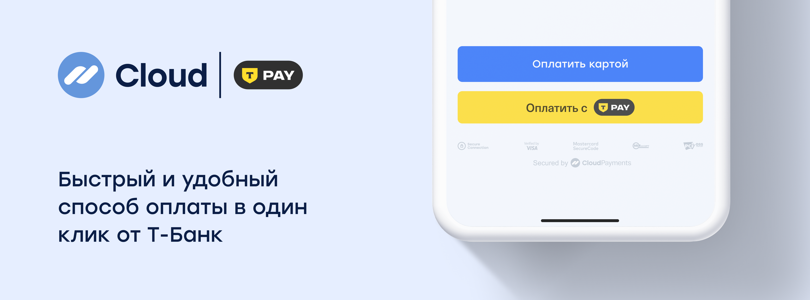

# T-Pay



CloudPayments предлагает метод оплаты в один клик T-Pay. Покупатель может выбрать любой счет для списания в приложении «Т-Банк», а также копить кэшбэк Т-Банк для последующих покупок.

Оплаты по T-Pay можно принимать через SDK. Доступна реализация как через платёжную форму CloudPayments, так и отдельной кнопкой.

Подробнее см. в разделе документации:

- SDK для [iOS](sdk-ios.md)
- SDK для [Android](sdk-android.md)

## Получение ссылки для оплаты
### Описание
Метод предназначен для получения платёжной ссылки. Поддерживает оплату в веб-версии (desktop и mobile web) и в мобильном приложении.

В ответе возвращается параметр `QrUrl`, содержащий URL для перенаправления клиента. Как правило, возвращается HTTPS-ссылка, однако в зависимости от комбинации параметров `Device`, `Os` и `Webview` может быть возвращён deeplink.

Для проведения платежа необходимо перенаправить клиента на полученный URL. При открытии ссылки в мобильном браузере может произойти автоматический переход в мобильное приложение банка.

### Адрес метода
https://api.cloudpayments.ru/payments/qr/tinkoffpay/link

### Параметры запроса

Параметр | Формат | Применение | Описание
--------- | ------- | ----------- | ----------- 
publicId |	String |	Обязательный |	Идентификатор сайта, который находится в ЛК
Amount | decimal | Обязательный| Cумма платежа в валюте, разделитель точка. Количество не нулевых знаков после точки – 2
Currency | string | Обязательный| Валюта: RUB (см. [справочник](handbook.md#список-валют))
Scheme | enum string | Обязательный | Схема проведения платежа (см. [Виды операций](handbook.md#типы-операций)). <br />Возможные значения: `0` - одностадийная оплата `1` - двухстадийная оплата
Browser | string | Обязательный | Название браузера клиента на основании userAgent браузера. <br />Пример значения: `Chrome`, `Firefox`, `MIUI Browser`, `Opera`
Os | string | Обязательный | Операционная система устройства плательщика. <br />Пример значения: `Android`, `iOS`, `Windows`
Webview | bool | Обязательный | Признак открытия браузера в режиме webview. <br />Возможные значения: `true` - для оплат через webview `false` - для оплат без webview
Device | enum string | Обязательный | Признак устройства плательщика. <br />Возможные значения: <br />`MobileApp` - вызов оплаты из мобильного приложения <br />`DesktopWeb` - вызов оплаты из браузера с десктопа <br />`Mobile` - вызов из браузера с мобильного устройства
SuccessRedirectUrl | string | Обязательный |Url для перенаправления клиента после успешной оплаты. <br />После проведения платежа, клиент будет перенаправлен на указанный адрес из мобильного приложения Банка. 
FailRedirectUrl | string | Обязательный | Url для перенаправления клиента после неуспешной оплаты. <br />После проведения платежа, клиент будет перенаправлен на указанный адрес из мобильного приложения Банка.
IpAddress | string | Необязательный | IP-адрес плательщика
AccountId | string | Необязательный | Идентификатор пользователя
Email | string | Необязательный | E-mail плательщика
InvoiceId | string | Необязательный | Номер счёта или заказа
Description | string | Необязательный | Назначение платежа в свободной форме
JsonData | json | Необязательный | Любые другие данные, которые будут связаны с транзакцией, в том числе [инструкции](api/17-sozdanie-podpiski-na-rekurrentnye-platezhi.md) для создания подписки или формирования [онлайн-чека](online-kassa.md#формат-передачи-данных-для-онлайн-чека) должны обёртываться в объект `cloudpayments`. Мы зарезервировали названия следующих параметров и отображаем их содержимое в реестре операций, выгружаемом в Личном Кабинете: `name`, `firstName`, `middleName`, `lastName`, `nick`, `phone`, `address`, `comment`, `birthDate`
TtlMinutes | int | Необязательный | Время в течение которого будет доступна оплата по QR-коду / ссылке на оплату. <br />Если параметр не передан, оплату можно будет совершить в течение 24 часов.<br />**Важно:**<br />- Значение 0 считается **некорректным** и может привести к ошибке обработки запроса.<br />- Если временное ограничение не требуется, параметр следует **не передавать** или явно указать как `null`.
SaveCard | bool | Необязательный | Признак сохранения карточного токена для проведения оплаты по сохранённой карте (см. [Оплата по токену (рекарринг)](api/04-oplata-po-tokenu-rekarring.md)). <br />Возможные значения: `true` - после успешной оплаты будет возвращён карточный токен, `false` - токен не будет возвращаться (по-умолчанию) <br />Параметр SaveCard обрабатывается только при включении настройки "Сохранение токена карты" в Личном Кабинете. При включении настройки "Сохранять принудительно", параметр SaveCard будет игнорироваться.

В ответ сервер возвращает JSON с тремя составляющими:

- поле **success** — результат запроса;
- поле **message** — описание ошибки;
- объект **model** — расширенная информация.

Возможные варианты ответа:

1. Некорректно сформирован запрос:
  - **success** — false
  - **message** — описание ошибки
2. Транзакция отклонена:
  - **success** — false
  - **model** — информация о транзакции и код ошибки
3. Транзакция принята:
  - **success** — true
  - **model** — информация о транзакции

<aside class="notice">Результат запроса (поле Success) не отражает статус транзакции, а лишь свидетельствует об успешности/неуспешности запроса API. Статус транзакции отражен в дополнительном поле Status, также его можно узнать в результате получения <a href="notifications.md">уведомлений</a>. Интерпретацию статусов транзакции смотрите в <a href="handbook.md#статусы-операций">справочнике</a>.</aside>

### Пример запроса
```json
{
    "Amount" : "10",
    "AccountId": "someId",
    "InvoiceId": 12345,
    "Browser" : "Chrome",
    "Currency" : "RUB",
    "Device" : "Mobile",
    "Description" : "Оплата по T-Pay",
    "Email" : "email@email.com",
    "IpAddress": "123.123.123.123",
    "Os" : "Android",
    "Scheme" : 1,
    "TtlMinutes" : 30,
    "SuccessRedirectUrl" : "https://cp.ru",
    "FailRedirectUrl" : "https://cp.ru",
    "Webview" : false
}

```

### Пример ответа

```json 
{
    "Model": {
        "QrUrl": "{URL-адрес}",         // содержит url-адрес для редиректа
        "QrImage": null,                
        "TransactionId": 11122233344,   // id транзакции CloudPayments
        "MerchantOrderId": "12345",     // переданный InvoiceId
        "ProviderQrId": "",
        "Amount": 10,
        "Message": "Created",     
        "IsTest": false
    },
    "Success": true,
    "Message": null
}
```
