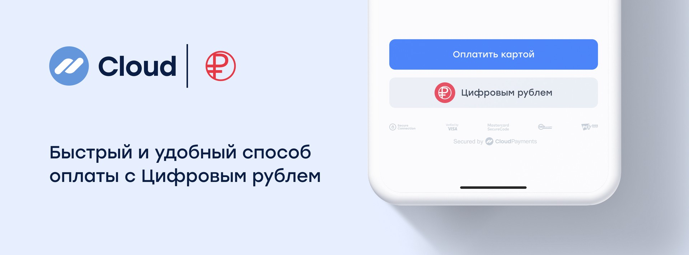

# Digital ruble

## Accepting digital rubles starting September 1, 2026

The digital ruble is a digital form of the Russian national currency issued by the Bank of Russia. It is equivalent to a cash ruble and is used for payments through the Bank of Russia's platform.

## Who the requirements apply to

Starting September 1, 2026, merchants and service providers will be required to accept digital rubles if they meet all of the following criteria:

* Generated revenue exceeding 120 million rubles in the previous year.
* Use the services of a bank recognized as significant in the payment services market.
* Accept payments from individuals.

## How the requirements will be expanded

Starting September 1, 2027, the requirements will extend to companies with annual revenue exceeding 30 million rubles. Starting September 1, 2028, they will apply to all other merchants with annual revenue of at least 20 million rubles.

## Who the requirements do not apply to

Companies with total annual revenue of less than 20 million rubles are not required to accept digital rubles.

The requirement also does not apply to:

* Individual retail outlets with annual revenue of less than 5 million rubles, even if the company's total annual revenue exceeds 20 million rubles.
* Points of sale without internet access.

## Digital ruble support in CloudPayments

CloudPayments plans to start accepting one-time digital ruble payments on September 1, 2026. These transactions will be displayed within the dashboard and included in transaction registers and financial reporting.

Until the end of 2026, the fee for accepting digital ruble payments will be 0%. Recurring payments and saving payment details for subsequent payments will not be supported at launch.

## How to connect

If you already accept payments via CloudPayments, contact your account manager or send a message to support via the chat in the dashboard.

If you do not yet work with CloudPayments, submit a [request to connect](https://cloudpayments.ru/#section-request).

Integration documentation will be provided to existing clients upon request and to new clients after they connect to CloudPayments.
