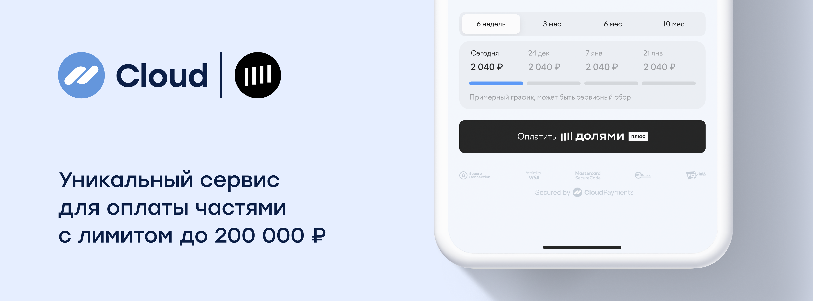

# Dolyame



CloudPayments offers the Dolyame payment method. The user can split the payment into four parts, and the store receives the full amount on the next business day.

## Integration methods
* In the payment [widget](mpf.md) and [CMS](https://cloudpayments.ru/integration/cms)/[CRM](https://cloudpayments.ru/integration/crm) modules
* In [CloudInfoshop](https://cloudpayments.ru/infoshop) (storefront created from the dashboard)
* In [orders](api/22-sozdanie-scheta-dlya-otpravki-po-pochte.md)
* In payment links generated in the dashboard
* Via the API

## Connection

To connect this payment method, contact your dedicated manager or write to the following email: [assistant@cp.ru](mailto:assistant@cp.ru)

For technical issues, contact support at [support@cp.ru](mailto:support@cp.ru)


## Embedded payment button

You can add a Dolyame payment button to your website. This method works through the CloudPayments public API and allows you to embed a separate payment button on your form.

The interface is available at [api.cloudpayments.ru](https://api.cloudpayments.ru/)

### Method POST /payments/altpay/pay

This method is used to obtain a payment link by submitting a Dolyame application.

There is no [HTTP Basic Auth](https://en.wikipedia.org/wiki/Basic_access_authentication) authentication for this method. Instead, the terminal ID parameter `PublicId` is used in the request body.

**URL:** /payments/altpay/pay

**METHOD:** POST

**BODY:**
The request must have a non-empty request body.

| Parameter | Format | Required  | Description | Example |
|---|---|---|---|---|
| PublicId | string | Yes | Terminal ID | `pk_0fe1d5c9cb47e8cf8d96102201419` |
| AltPayType | string | Yes | Payment type.<br />Pass the `TcsBnplDolyame` value | `TcsBnplDolyame` |
| Amount | number<br />  | Yes | Payment amount, dot as the decimal separator. Number of decimal places: 2 | `1000` |
| Scheme | enum<br />string | Yes | Payment processing method (see [Transaction types](handbook.md#operation-types))<br />Possible values: <br />`0` for single-stage payment <br />`1` for two-stage payment | `0` |
| InvoiceId | string | No | Invoice number/ID.<br />Passed in the [Check](notifications.md#check) notification and can be used to validate the order number | `462651419` |
| Description | string | No | Free-form payment description | `Payment for goods at http://example.com` |
| AccountId | string | No | Payer ID | `usermail@example.com` |
| Email | string | No | Payer email for receiving payment confirmation | `usermail@example.com` |
| SuccessRedirectUrl | string | No | Return link for a successful payment | `https://success-page.ru` |
| FailRedirectUrl | string | No | Return link for a failed payment | `https://fail-page.ru` |
| JsonData | JSON | No | Any other data that will be related to the transaction, in `json` object format | `{\"Phone\": \"+71234567890\"}` |
| CultureName | string | No | Language for notifications and receipts. Possible values: "ru-RU", "en-US" ([see reference](api/26-lokalizatsiya.md)).<br />If not passed, "ru-RU" is used by default | `ru-RU` |

**RESPONSE:**

The server returns a JSON file with the following three properties:

* **Success**: request result
* **Message**: error description
* **Model**: extended information on payment

Possible responses:

1. Malformed request:
   * **Success**: false
   * **Message**: error description
2. Payment session initialization failed:
   * **Success**: false
   * **Model**: transaction information and an error code
3. Session initialization completed successfully:
   * **Success**: true
   * **Model**: transaction information
     * The `Model.ExtensionData.Link` field will contain the link to the payment form, which needs to be opened so the user can complete the payment by submitting an application on that payment form.

<aside class="notice">Request result from the <code>Success</code> field does not reflect transaction status; it only indicates the success or failure of the API request. Transaction status is reflected in the additional <code>Status</code> field, and can also be obtained via received <a href="notifications.md">notifications</a>. For the interpretation of transaction statuses, see <a href="handbook.md#transaction-statuses">reference</a>.</aside>

| Parameter | Format | Required | Description |
|---|---|---|---|
| Model | object | Yes | Data of the created transaction |
| Model.TransactionId | long | Yes | Transaction ID |
| Model.Amount | number | Yes | Transaction amount |
| Model.IsTest | bool | No | Test mode indicator |
| ExtensionData | object | No | Object containing additional payment data |
| ExtensionData.Link<br />  | string | No | Link to the application form on the [website](http://dolyame.ru/) |
| Success | bool | Yes | Whether the request was successful |
| Message | string | No | Message describing the request status |
| ErrorCode | number | No | Error code (if any) |

**Request example**

```llvm
{
  "PublicId": "pk_0fe1d5c9cb47e8cf8d96102201419",
  "AltPayType": "TcsBnplDolyame",
  "Amount": 1000,
  "Description": "Payment at point N",
  "AccountId": "email@email.com",
  "InvoiceId": "order_no4009",
  "CultureName": "ru-RU",
  "Scheme": "1",
  "SuccessRedirectUrl": "https://success-page.ru",
  "FailRedirectUrl": "https://fail-page.ru"

}
```

**Response example**

```llvm
{
  "Model": {
          "TransactionId": 183930901,
          "Amount": 1000,
          "IsTest": true
          },
  "ExtensionData": {
                "Link": "https://dolyame.ru/form/demoPayment-52030933-b65e-4e5a-acdc/example/example"
                },
  "Success": true,
  "Message": null,
  "ErrorCode": null
}
```
