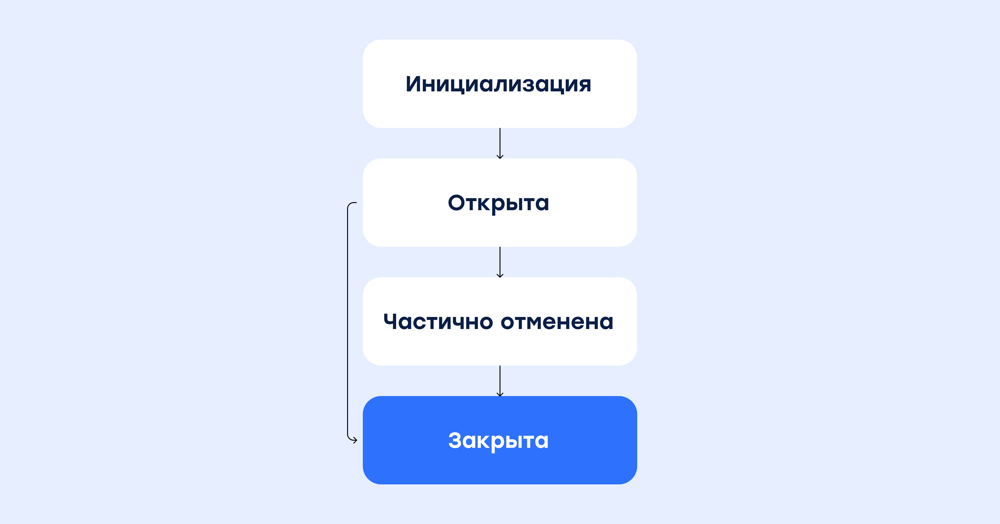

# Escrow service

## Product description

The Escrow service enables settlement processing between two individuals for the sale of goods or services. In this case, interaction between individuals does not happen directly, but rather through the Platform, a legal entity that facilitates the listing of the Product on its storefront, helps the Seller find a buyer, and organizes dispute resolution when necessary. The Platform monitors the transaction progress and instructs CloudPayments to charge the buyer's card at the time of purchase. Once the seller successfully fulfills their obligations (for example, upon completion of the agreed services or works, or successful delivery of the product), the Platform initiates the payout to the seller's card.

## Definitions and terms

**Payer**: an individual who sends money.
**Recipient**: an individual who receives money.
**Platform**: an intermediary that acts as a guarantor of the security of the transaction and determines whether the parties have fulfilled their obligations. In case of disputes, it acts as an Arbitrator and bears financial liability.
**Transaction** is the process of acquiring goods/services from one individual to another.
**Payment**: the purchase of goods or services from an individual.
**Payout**: the receipt of remuneration by an individual who has provided a service or sold a product.
**Widget**: a pop-up form used to enter the payer's card details and email address.
**Checkout**: a script embedded into a website that collects card details from a specified form and uses them to generate a cryptogram for payment processing via the API.
**AccumulationId**: a unique transaction ID assigned during the initial transaction.
**TransactionId**: a unique transaction ID.

## Connection setup

To enable the Escrow service, you must submit a request to your account manager or specify this during the onboarding phase with your assigned manager.

<aside class="warning">Operating via Escrow requires setting up 2 terminals: one for processing payments and another for processing payouts.</aside>

<aside class="warning">Escrow payments and payouts are available exclusively via bank card or a token generated during a card payment. Escrow is not supported for any other payment methods, including international card payments.<br /><br />Also, please note that not all acquiring banks connected to CloudPayments support the Escrow service. Please contact your account manager for details.</aside>

## Workflows

1. Accumulating several payments and making a single payout (N:1)
2. Splitting a single payment into multiple payouts (1:N)

## Escrow status model



## N:1

### Widget integration diagram

The variable specifying the transaction type is located within the `cp.constant.escrow` object. It determines the escrow workflow:

1. Multiple payments to a single payout

2. A single payment to multiple payouts

```llvm
{
  NToOne: 0,  // For N:1 workflow
  OneToN: 1  // For 1:N workflow
}
```

If this variable is omitted, the system automatically defaults to the **N:1** transaction protocol.

**Example**:

```yaml
cp.constant.escrow.NToOne // Transaction type variable = 0
cp.constant.escrow.OneToN // Transaction type variable = 1
```

**Payment (initial accumulation)**

```js
var widget = new cp.CloudPayments();

  const intentParams = {
    publicTerminalId: "test_api_00000000000000000000002",
    paymentSchema: 'Dual',
    description: Payment for order #...",
    amount: 100,
    currency: "RUB",
    culture: "ru-RU",
    skin: "classic",
    externalId: 'string',
    receiptEmail: "user@email.com",
    userInfo: {
      email: "user@email.com",
      phone: "+71234567890",
    },
    metadata: {
      myProp: "myProp value",
    },
    escrow: {
      startAccumulation: true,
      accumulationId: null,
      escrowType: "NToOne"
    },
  };

  widget.oncomplete = (result) => {
      console.log(result);
  }

  widget.start(intentParams).then(function(widgetResult) {
    console.log('result', widgetResult); // Success callback
  }).catch(function(error) {
    console.log('error', error); // Error callback
  });
```

In response to the request, a unique **EscrowAccumulationId** ID will be received within the [Pay](notifications.md#pay) notification.

Also, if the transaction is successful, the **EscrowAccumulationId** will be included in all webhooks except for the `Check` webhook.

**Payment (for an active accumulation)**

For subsequent requests (payments) within the created escrow transaction, fields **accumulationId**, **startAccumulation**, **escrowType** must be added to the `escrow` object.

**Example**:

```js
Escrow:{
    startAccumulation: false,
    escrowType: cp.constant.escrow.NToOne,
    accumulationId: "4733183a-c6f6-4c1b-8ff1-fb7c43ed1695" // Payment for accumulation already created
}
```


### Checkout API integration workflow

**Payment (initial accumulation)**

You must send a request to the **payments/cards/charge** (or **auth**) endpoint. In the request body, within the `escrow` object, you must pass `"StartAccumulation": true` and the transaction type as `"EscrowType":0` or `"EscrowType": “NToOne"` . This means that the `EscrowType` value can be passed either as an integer value (0/1) or as a string representation (NToOne/OneToN).

```json
"Escrow":{
    "StartAccumulation":true,
    "EscrowType": "NToOne"
}
```

The response returns a unique `EscrowAccumulationId` ID.

```json
{
    "Model": {
        "ReasonCode": 0,
        "PublicId": "pk_71efb26a18397ec61b755221123cc",
        "TerminalUrl": "https://example.com",
        "TransactionId": 10649404,
        "Amount": 215,
        "Currency": "RUB",
        "CurrencyCode": 0,
        "PaymentAmount": 215,
        "PaymentCurrency": "RUB",
        "PaymentCurrencyCode": 0,
        "InvoiceId": null,
        "AccountId": null,
        "Email": null,
        "Description": null,
        "JsonData": "{\"Phone\": \"+71234567890\" }",
        "CreatedDate": "/Date(1640787010601)/",
        "PayoutDate": null,
        "PayoutDateIso": null,
        "PayoutAmount": null,
        "CreatedDateIso": "2021-12-29T14:10:10",
        "AuthDate": "/Date(1640787010877)/",
        "AuthDateIso": "2021-12-29T14:10:10",
        "ConfirmDate": null,
        "ConfirmDateIso": null,
        "AuthCode": "A1B2C3",
        "TestMode": true,
        "Rrn": null,
        "OriginalTransactionId": null,
        "FallBackScenarioDeclinedTransactionId": null,
        "IpAddress": "127.0.0.1",
        "IpCountry": "RU",
        "IpCity": "Novosibirsk",
        "IpRegion": "Novo-Siberian region",
        "IpDistrict": "Siberian Federal District",
        "IpLatitude": 1.03923,
        "IpLongitude": 1.927818,
        "CardFirstSix": "411111",
        "CardLastFour": "1111",
        "CardExpDate": "11/23",
        "CardType": "Visa",
        "CardProduct": "C",
        "CardCategory": "Visa Signature (Signature)",
        "EscrowAccumulationId": "365b6942-94e8-4c5b-aff5-392dc1a51c28",
        "IssuerBankCountry": "RU",
        "Issuer": "CloudPayments",
        "CardTypeCode": 0,
        "Status": "Authorized",
        "StatusCode": 2,
        "CultureName": "ru",
        "Reason": "Approved",
        "CardHolderMessage": "Payment successfully processed",
        "Type": 0,
        "Refunded": false,
        "Name": null,
        "Token": null,
        "SubscriptionId": null,
        "GatewayName": "Test",
        "AndroidPay": false,
        "WalletType": "",
        "TotalFee": 0
    },
    "Success": true,
    "Message": null
}
```

In response to the request, a unique `EscrowAccumulationId` ID will be received within the [Pay](notifications.md#pay) notification

Also, if the transaction is successful, the `EscrowAccumulationId` will be included in all webhooks except for the `Check` webhook.

**Payment (for an active accumulation)**

For subsequent requests (payments), within the created escrow transaction, it is necessary to include the `AccumulationId` ID in the **Escrow** object of the `payments/cards/charge` request by specifying `"StartAccumulation": false` and the transaction type as `"EscrowType":0` or `"EscrowType": “NToOne"`:

```json
"Escrow":{
    "StartAccumulation":false,
    "EscrowType": "NToOne",
    "AccumulationId": "365b6942-94e8-4c5b-aff5-392dc1a51c28",
}
```

The response:

```json
{
    "Model": {
        "ReasonCode": 0,
        "PublicId": "pk_71efb26a18397ec61b755221123cc",
        "TerminalUrl": "https://example.com",
        "TransactionId": 10649405,
        "Amount": 215,
        "Currency": "RUB",
        "CurrencyCode": 0,
        "PaymentAmount": 215,
        "PaymentCurrency": "RUB",
        "PaymentCurrencyCode": 0,
        "InvoiceId": null,
        "AccountId": null,
        "Email": null,
        "Description": null,
        "JsonData": "{\"Phone\": \"+71234567890\"}",
        "CreatedDate": "/Date(1640787317880)/",
        "PayoutDate": null,
        "PayoutDateIso": null,
        "PayoutAmount": null,
        "CreatedDateIso": "2021-12-29T14:15:17",
        "AuthDate": "/Date(1640787319410)/",
        "AuthDateIso": "2021-12-29T14:15:19",
        "ConfirmDate": null,
        "ConfirmDateIso": null,
        "AuthCode": "A1B2C3",
        "TestMode": true,
        "Rrn": null,
        "OriginalTransactionId": null,
        "FallBackScenarioDeclinedTransactionId": null,
        "IpAddress": "127.0.0.1",
        "IpCountry": "RU",
        "IpCity": "Novosibirsk",
        "IpRegion": "Novo-Siberian region",
        "IpDistrict": "Siberian Federal District",
        "IpLatitude": 1.03923,
        "IpLongitude": 1.927818,
        "CardFirstSix": "411111",
        "CardLastFour": "1111",
        "CardExpDate": "11/23",
        "CardType": "Visa",
        "CardProduct": "C",
        "CardCategory": "Visa Signature (Signature)",
        "EscrowAccumulationId": "365b6942-94e8-4c5b-aff5-392dc1a51c28",
        "IssuerBankCountry": "RU",
        "Issuer": "CloudPayments",
        "CardTypeCode": 0,
        "Status": "Authorized",
        "StatusCode": 2,
        "CultureName": "ru",
        "Reason": "Approved",
        "CardHolderMessage": "Payment successfully processed",
        "Type": 0,
        "Refunded": false,
        "Name": null,
        "Token": null,
        "SubscriptionId": null,
        "GatewayName": "Test",
        "AndroidPay": false,
        "WalletType": "",
        "TotalFee": 0
    },
    "Success": true,
    "Message": null
}
```

**Payout**

To complete the transaction, you must send the request to the **payments/token/topup** endpoint, specifying the `AccumulationId` ID and the array of transactions to be paid out:

```json
"Escrow": {
  "AccumulationId": "365b6942-94e8-4c5b-aff5-392dc1a51c28",
  "TransactionIds": [10649405, 10649404],
  "EscrowType": "NToOne"
}
```

The array of payment transactions for the payout must contain only transactions processed through the payment terminal associated with the current **AccumulationId** ID.
Payouts will be made only for the **TransactionId** values that have been specified in **TransactionIds** array in the **payments/token/topup** request.
It is not possible to process payouts for the omitted transactions, as the transaction will already be closed. Therefore it is impossible to perform either a payment or a payout against a closed escrow transaction.

<aside class="warning">Any payment transactions that were not submitted for escrow closure will be automatically refunded to the payer.</aside>

### Restrictions

The payout amount must be less than or equal to the total payment amount.

None of the transactions specified in the payout array must have any cancellations or full refunds (partial refunds are allowed).

If a payment request is sent with an `AccumulationId` for which a payout has already been processed, the payment will be declined.

All transactions submitted for a payout must meet the following criteria:

* Share the same `AccumulationId`
* Be unpaid
* Be in the RUB currency
* Be of the **Payment** type
* Be in the **Completed** status

## 1\:N

### Widget integration diagram

The variable specifying the transaction type is located within the `cp.constant.escrow` object. It determines the escrow workflow:

    1. Multiple payments to a single payout

    2. A single payment to multiple payouts

```llvm
{
  NToOne: 0,
  OneToN: 1
}
```

**Example**:

```yaml
cp.constant.escrow.NToOne // Transaction type variable = 0
cp.constant.escrow.OneToN // Transaction type variable = 1
```

**Payment**

```js
var widget = new cp.CloudPayments();

  const intentParams = {
    publicTerminalId: "test_api_00000000000000000000002",
    paymentSchema: 'Dual',
    description: Payment for order #...",
    amount: 100,
    currency: "RUB",
    culture: "ru-RU",
    skin: "classic",
    externalId: 'string',
    receiptEmail: "user@email.com",
    userInfo: {
      email: "user@email.com",
      phone: "+71234567890",
    },
    metadata: {
      myProp: "myProp value",
    },
    escrow: {
      startAccumulation: true,
      accumulationId: null,
      escrowType: "OneToN"
    },
  };

  widget.oncomplete = (result) => {
      console.log(result);
  }

  widget.start(intentParams).then(function(widgetResult) {
    console.log('result', widgetResult); // Success callback
  }).catch(function(error) {
    console.log('error', error); // Error callback
  });
```

In response to the request, a unique **EscrowAccumulationId** ID will be received within the [Pay](notifications.md#pay) notification.

Also, if the transaction is successful, the `EscrowAccumulationId` will be included in all webhooks except for the `Check` webhook.

### Checkout API integration workflow

**Payment**

You must send a request to the **payments/cards/charge** (or **auth**) endpoint. In the request body, within the `escrow` object, you must pass `"StartAccumulation": true` and the transaction type as `"EscrowType":1` or `"EscrowType": "OneToN"` . This means that the `EscrowType` value can be passed either as an integer value (0/1) or as a string representation (NToOne/OneToN).

```json
"Escrow":{
    "StartAccumulation":true,
    "EscrowType": "OneToN"
}
```

The response returns a unique `EscrowAccumulationId` ID.

```json
{
    "Model": {
        "ReasonCode": 0,
        "PublicId": "pk_71efb26a18397ec61b755221123cc",
        "TerminalUrl": "https://example.com",
        "TransactionId": 10649404,
        "Amount": 215,
        "Currency": "RUB",
        "CurrencyCode": 0,
        "PaymentAmount": 215,
        "PaymentCurrency": "RUB",
        "PaymentCurrencyCode": 0,
        "InvoiceId": null,
        "AccountId": null,
        "Email": null,
        "Description": null,
        "JsonData": "{\"Phone\": \"+71234567890\"}",
        "CreatedDate": "/Date(1640787010601)/",
        "PayoutDate": null,
        "PayoutDateIso": null,
        "PayoutAmount": null,
        "CreatedDateIso": "2021-12-29T14:10:10",
        "AuthDate": "/Date(1640787010877)/",
        "AuthDateIso": "2021-12-29T14:10:10",
        "ConfirmDate": null,
        "ConfirmDateIso": null,
        "AuthCode": "A1B2C3",
        "TestMode": true,
        "Rrn": null,
        "OriginalTransactionId": null,
        "FallBackScenarioDeclinedTransactionId": null,
        "IpAddress": "127.0.0.1",
        "IpCountry": "RU",
        "IpCity": "Novosibirsk",
        "IpRegion": "Novosibirsk region",
        "IpDistrict": "Siberian Federal District",
        "IpLatitude": 1.03923,
        "IpLongitude": 1.927818,
        "CardFirstSix": "411111",
        "CardLastFour": "1111",
        "CardExpDate": "11/23",
        "CardType": "Visa",
        "CardProduct": "C",
        "CardCategory": "Visa Signature (Signature)",
        "EscrowAccumulationId": "365b6942-94e8-4c5b-aff5-392dc1a51c28",
        "IssuerBankCountry": "RU",
        "Issuer": "CloudPayments",
        "CardTypeCode": 0,
        "Status": "Authorized",
        "StatusCode": 2,
        "CultureName": "ru",
        "Reason": "Approved",
        "CardHolderMessage": "Payment successfully processed",
        "Type": 0,
        "Refunded": false,
        "Name": null,
        "Token": null,
        "SubscriptionId": null,
        "GatewayName": "Test",
        "AndroidPay": false,
        "WalletType": "",
        "TotalFee": 0
    },
    "Success": true,
    "Message": null
}
```

In response to the request, a unique `EscrowAccumulationId` ID will be received within the [Pay](notifications.md#pay) notification.

Also, if the transaction is successful, the `EscrowAccumulationId` will be included in all webhooks except for the `Check` webhook.

**Payout**

To complete the transaction, you must send the request to the **payments/token/topup** endpoint, specifying the `AccumulationId` ID and an array of transactions to be paid out (the array should contain only one `TransactionId`, according to the escrow workflow):

```json
"Escrow": {
  "AccumulationId": "365b6942-94e8-4c5b-aff5-392dc1a51c28",
  "TransactionIds": [10649404],
  "EscrowType": "OneToN"
}
```

<aside class="warning">Payouts can be processed until the sum of all payouts equals the total escrow transaction amount.</aside>

There are two methods for closing an escrow transaction:

1. Pass the `"FinalPayout": true` parameter within the `Escrow` object (this closes the escrow transaction even if the total payout amount is less than the original payment amount)

```json
"Escrow": {
  "AccumulationId": "365b6942-94e8-4c5b-aff5-392dc1a51c28",
  "TransactionIds": [10649404],
  "EscrowType": "OneToN",
  "FinalPayout": true
}
```

2. When the sum of all payouts equals the original payment amount, the escrow transaction will be closed automatically.

Payments will be made only for the `TransactionId` specified in the `TransactionIds` array in the **payments/token/topup** request (for the 1:N workflow, this array must contain only a single payment transaction ID).

### Restrictions

The payout amount must be less than or equal to the total payment amount.

The payment transaction must not have any cancellations or full refunds (partial refunds are allowed).

All transactions submitted for a payout must meet the following criteria:

* Share the same `AccumulationId`
* Be in the RUB currency
* Be in the **Completed** status
* Be processed within a single workflow (OneToN)
* The escrow transaction must not be closed (meaning, the `"FinalPayout": true` parameter was not passed, and the total payout amount is less than the original payment amount)

## Retrieve transaction status by `AccumulationId`

To retrieve information, you must send an HTTP request with the `Basic Auth` authorization type.
Use the terminal's public key (PK) as the username. Both the payment and payout terminals can be used.
The password is the API secret associated with that specific PK.

<aside class="notice">The PK and API secret can be found in the dashboard under the website settings.</aside>

<aside class="warning">Information retrieval is only available for the `AccumulationId` values generated within this specific pair of terminals.</aside>

## Retrieve Escrow service information for both types of transaction (N:1 and 1\:N)

A public method for retrieving information by an array of **EscrowAccumulationId** values, which allows you to obtain:

* An array of unpaid payments:
    * **Payments** transaction ID
    * Transaction status (string value)
    * Transaction amount
* An array of paid-out payments (included in the payout):
    * **Payments** transaction ID
    * Transaction status (string value)
    * Transaction amount
* An array of refunds for all transactions:
    * **Payments** transaction ID
    * Transaction status (string value)
    * Transaction amount
* An array of payout transactions (for the 1:N workflow):
    * **Payout** transaction ID
    * Transaction status (string value)
    * **Payout** transaction amount
    * The **IsFinalPayout** escrow closure flag
* Balance
    * Balance = PaymentsSum - RefundsSum - PayoutsSum

**Endpoint:**

https://api.cloudpayments.ru/Escrow/GetEscrowInfo

**Request example:**

```json
{
  "EscrowAccumulationIds" : ["7de3281f-4339-4e2e-9df9-06dcfbcdceac"]
}
```

**Example response:**

```json
{
    "Model": [
        {
            "Status": "Closed",
            "PaidoutTransactions": [
                {
                    "Id": 608632,
                    "Status": "Completed",
                    "Amount": 1500.0
                },
                {
                    "Id": 608631,
                    "Status": "Completed",
                    "Amount": 901.0
                }
            ],
            "NotPaidoutTransactions": [
                {
                    "Id": 608632,
                    "Status": "Completed",
                    "Amount": 1500.0
                },
                {
                    "Id": 608634,
                    "Status": "Completed",
                    "Amount": 901.0
                }
            ],
            "PayoutTransactions": [
                {
                    "Id": 608635,
                    "Status": "Completed",
                    "Amount": 1500.0,
                    "IsFinalPayout": true
                },
                {
                    "Id": 608636,
                    "Status": "Completed",
                    "Amount": 901.0,
                    "IsFinalPayout": false
                }
            ],
            "RefundedTransactions": null,
            "EscrowAccumulationId": "2533b003-da5d-463f-af85-fe6621354cd6",
            "Balance": 0.0
        }
    ],
    "Success": true,
    "Message": null
}
```

### The `Status` field values for Escrow transaction:

* Open
* Closed
