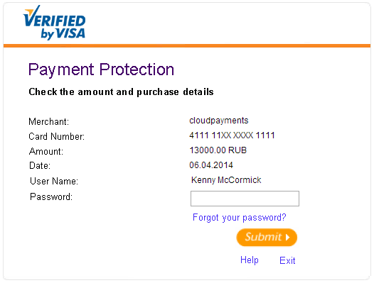

# General information

## Terms and definitions

* **System**: the CloudPayments payment gateway.
* **Merchant**: a business that uses the system.
* **API**: a software interface for interacting with a system through https://api.cloudpayments.ru.
* **Dashboard**: the merchant space in the system, available at https://merchant.cloudpayments.ru.
* **Card**: a bank card issued by the Visa, Mastercard, or Mir payment system.
* **Acquirer**: the settlement bank.
* **Issuer**: the bank that issued the card.
* **Holder**: a person to whom the issuer has issued a card for use.
* **Widget**: a payment form provided by the system for the cardholder to enter card details and complete authorization.
* **3D Secure**: a protocol for verifying the cardholder's identity with the issuer.

## Operation types

The system involves two types of transactions: payment and refund.

* When the payment is made, the funds are transferred from the holder's account to the merchant. For a refund, the funds are transferred the other way around.
* The merchant issues a refund if the customer wants to return the product.
* The refund is always linked to a payment transaction, the amount of which is returned to the cardholder. Both the full payment and part of it can be refunded. The funds are usually returned to the cardholder's card on the same day, but sometimes, depending on the issuing bank, this can take up to 3 days.
* Unlike a refund, a payment transaction can be canceled.
* The merchant cancels a payment if it was made by mistake, for example, due to an incorrect amount or technical failure. There is one limitation: the transaction can only be canceled when using a two-stage payment scheme. At the same time, the funds will be released on the cardholder’s card almost instantly.

## Payment processing methods
There are two ways to process payments: single-stage and two-stage, also known as the **single message system** (SMS) and **dual message system** (DMS), respectively.

**Single-stage** payment is processed with a single command, which authorizes and subsequently debits the funds to the merchant.

**Two-stage** payment uses two separate commands: one for authorization and one for charging the funds. After successful authorization, the transaction amount is held on the cardholder's account, so they cannot use the funds. Next, the merchant has up to 7 days, depending on the card type, to confirm the transaction, after which the funds are debited. If the operation is not confirmed within this period, it will be canceled automatically. You can confirm either full authorization amount or part of it.
As a rule, a two-stage method is used to collect a deposit from the payer, for example, by rental companies or hotels.

Depending on the configuration, the system can automatically confirm two-stage payments after the specified number of days.

## Payment methods

Payment can be made in the following ways:

* Through the payment form, the [widget](mpf.md).
	You add a script to your website that opens a secure payment form, an iframe for entering card details.

* Via the [API](api/index.md) using a card cryptogram.
    A [checkout](checkout.md) script is integrated into your website to collect card details from any form, encrypt and generate a cryptogram for secure server-to-server transmission.

* Via the SDK for mobile apps.
    The mobile SDK is integrated into your [iOS](sdk-ios.md) or [Android](sdk-android.md) app to accept card payments directly from your customers' smartphones or tablets.

* Via the [API](api/index.md) using a card token: recurring payments.
    Following the first payment via the widget or by cryptogram, the system assigns a token to the card details. The token can be safely stored and used for merchant-initiated payments (one-click payments). The token is returned in the [Pay](notifications.md#pay) notification and in the API response

* Via a configured recurring payment plan.
   Following the first payment or a one-ruble authorization for card verification, a token is assigned to the card details. This token is then used [to create a subscription plan](api/17-sozdanie-podpiski-na-rekurrentnye-platezhi.md) for recurring payments. Payments are processed automatically by the system without the payer's confirmation. These payments follow a configured schedule, which can be set to once a day (or every few days), once a week (or every few weeks) or once a month (or every few months). If a scheduled payment attempt fails, a notification is sent, and the attempt is retried within a day. After three consecutive failed attempts, the subscription is automatically canceled.
   When creating a plan, a maximum number of billing cycles can be specified (for example, 12 months for a monthly subscription), after which the subscription will automatically terminate
* Customizable payment acceptance forms
   Payment forms allow foundations and other organizations to accept donations directly to their accounts using a configurable, customizable payment form. This form can be shared as a link _c.cloudpayments.ru/payments/_
  or as a QR code, which can be placed in both online broadcasts and offline marketing materials (flyers, brochures, etc.).
   The form makes it much easier to accept donations. In the new "Payment forms" section of the dashboard, you can create and customize up to 5 payment forms. The link and QR code for sending to payers become available once the form is saved.

## 3D Secure

3D Secure is the collective name for the security programs developed by Visa and Mastercard. The purpose of the program is to verify the identity of the cardholder, allowing the issuer to protect against unauthorized card use prior to payment. In practice, it works as follows: the cardholder enters their card details and is then redirected to the issuer's website to enter a password or verification code. Typically, the code is sent via SMS. If the code is entered correctly, the payment is processed. Otherwise, it is declined.

3D Secure is not triggered for all cards during checkout, but only for those whose issuing banks support the technology. Processing payments without 3D Secure is a less secure option.
