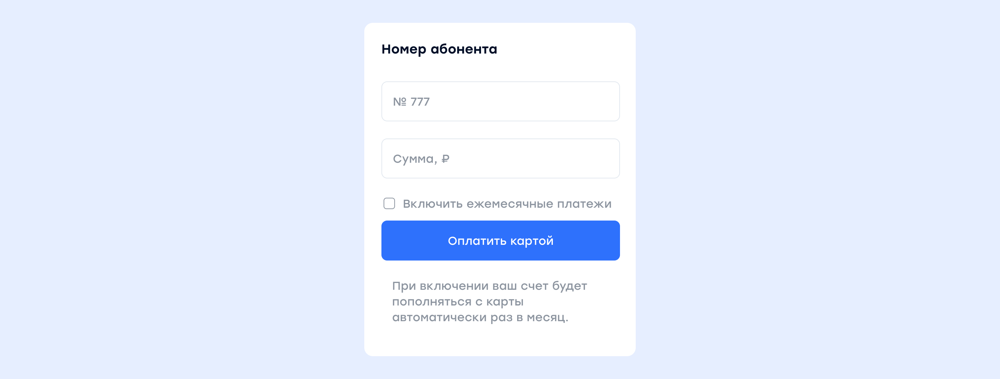
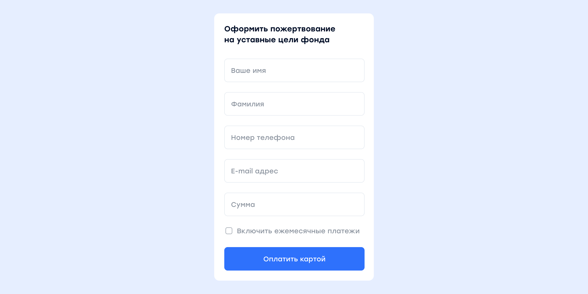
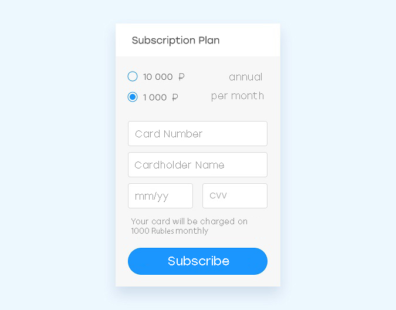
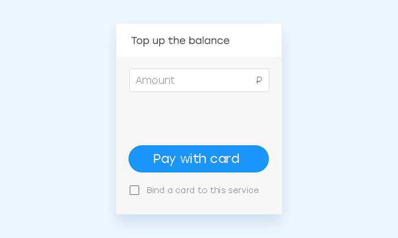
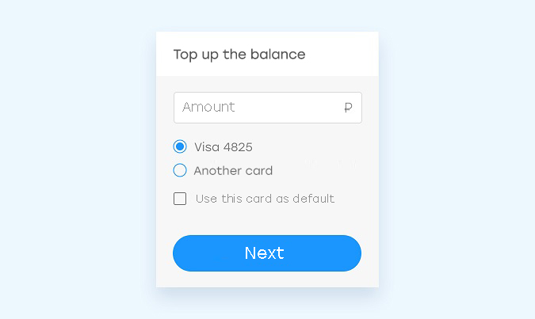
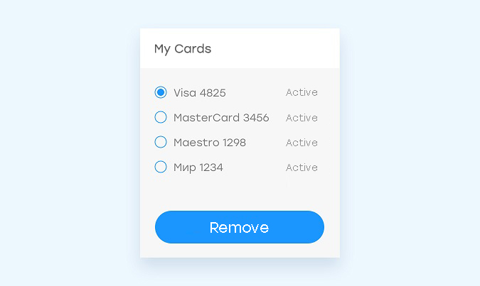

# Integration scenarios

The system offers various integration options, ranging from very simple to highly functional, depending on your requirements.

<aside class="notice">Integration without payment verification is not recommended. <br />Make sure to always verify the amount, order number, and payer's account ID.</aside>

## Payment form


If you do not need to verify payments before they are made, or record the fact of payment, do the following:

* Add the [widget installation script](mpf.md#widget-installation) to your website.
* Set up an email address for payment notifications in your <a href="https://merchant.cloudpayments.ru/" target="_blank">dashboard</a>.

## Payment registration


If you need to register payments in your system, but there is no need to verify them before they are made, do the following:

* Add the [widget script](mpf.md#widget-installation) to your website.
* Set up payment registration as follows:

	* Create a script to process [Pay notifications](notifications.md#pay), for example, **https://site.ru/webhooks/cloudpayments/pay**.
	* Add the payment registration logic and a JSON formatted response in the handler.
	* Enable sending Pay notifications in your <a href="https://merchant.cloudpayments.ru/" target="_blank">dashboard</a>.

## Payment verification and registration


If you need to verify and register payments in your system, do the following:

* Add the widget installation script to your website.
* Set up payment verification as follows:
	* Create a script to process [Check notifications](notifications.md#check), for example, **https://site.ru/webhooks/cloudpayments/check**.
	* Add the payment verification logic and a JSON formatted response in the handler.

* Set up payment registration as follows:
	* Create a script to process [Pay notifications](notifications.md#pay), for example, **https://site.ru/webhooks/cloudpayments/pay**.
	* Add the payment registration logic and a JSON formatted response in the handler.

* Enable sending Check and Pay notifications in the dashboard.

## Autopayments for internet providers


This payment solution is suitable for internet providers, mobile network operator, and telecoms. Notifications for payment verification and registration can be set up in either the CloudPayments format or the QIWI (OSMP) format.





**Form code:**

```js
    this.paySample3 = function () {
    var widget = new cp.CloudPayments();

    var userInfo = {};
    var auto = $('#recurrent-sample-3').is(':checked'); // Check

    if (auto) {// Enable subscription

        var accountId = $('#account-sample-3').val();
        var date = new Date(); // Current date
        date.setMonth(date.getMonth() + 1); // Next month
        date.setDate(date.getDate() - 1); // Minus one day

        var recurrent = { interval: 'Month', period: 1, startDate: date}; // Once a month starting from next month minus one day

        userInfo.accountId = "accountId" // Payer ID, required for creating a subscription
    }

    var amount = parseFloat($('#amount-sample-3').val());

    widget.start({
        publicTerminalId: 'test_api_00000000000000000000002', // ID from the dashboard
        description: 'Top up customer account ' + accountId, // Purpose
        paymentSchema: "Single" // Single-stage payment
        amount: amount, // Amount
        currency: 'RUB', // Currency
        recurrent: recurrent
        userInfo: userInfo
    },
    function (options) { // Success
        // Action on successful payment
    },
    function (reason, options) { // Fail
        // Action on failed payment
    });
};

$('#checkout-sample-3').click(paySample3);

```

<aside class="notice">The example above uses the `jQuery` library. </aside>

## Autopayments for charitable foundations


This payment solution is suitable for charitable foundations. First name, last name, phone number, email, and any other data from the form will be saved in the widget and sent to your server through a [Pay notification](notifications.md#pay).



**Form code:**

```js
    this.paySample4 = function () {
    var widget = new cp.CloudPayments();

    var userInfo = {// Donor details
        name: $('#name-sample-4').val(),
        lastName: $('#lastName-sample-4').val(),
        phone: $('#phone-sample-4').val(),
        accountId = $('#email-sample-4').val(); // Payer ID, required for creating a subscription
    };

    var recurrent = {};
    var auto = $('#recurrent-sample-4').is(':checked'); // Check

    if (auto) {// Enable subscription
        recurrent = { interval: 'Month', period: 1} // Once a month from next month
    }
    var amount = parseFloat($('#amount-sample-4').val());

    widget.start({
        publicTerminalId: 'test_api_00000000000000000000002', // ID from the dashboard
        description: 'Donation to the foundation ...', // Purpose
        amount: amount, // Amount
        currency: 'RUB', // Currency
        email: userInfo.accountId,
        userInfo: userInfo,
        recurrent: recurrent
    },
    function (options) { // Success
        // Action on successful payment
    },
    function (reason, options) { // Fail
        // Action on failed payment
    });
};

$('#checkout-sample-4').click(paySample4);
```

<aside class="notice">The example above uses the <code>jQuery</code> library. </aside>

## Subscription payments

If you need to charge your customers on a regular basis, according to a schedule, the scenario may be as follows:

* Your website needs user authentication that provides access to the dashboard.
* Before creating a subscription plan, inform the user about the tariff plan and payment frequency, and prompt them to enter their card details.



* In accordance with your business process, perform a 1-ruble authorization to verify the card, or charge the amount for the first subscription period.
* Obtain the card token through any API payment method or the [Pay notification](notifications.md#pay), and [create a recurring payment plan](api/17-sozdanie-podpiski-na-rekurrentnye-platezhi.md).

<aside class="notice">Passing the user ID in the <code>AccountId</code> parameter is required for obtaining the token.</aside>

* Subscribe to [Fail](notifications.md#fail) and [Recurrent](notifications.md#recurrent) notifications. After receiving a notification about a failed payment, inform the user that they need to check their card. When the subscription period ends or is canceled, stop providing the service.
* Add a payment history section showing at least the date and amount of each payment.

## One-click payments

 If you need to store card data on the payment gateway side for subsequent one-click payments without entering card details and without 3D Secure, the scenario may be as follows:

* Your website needs user authentication that provides access to the dashboard.
* During the first payment, offer the user the option to link their card so they do not need to enter their details with every payment.

 

 If the user agrees, save the card mask (type and last 4 digits) and the token in their profile after payment. The system returns the card details and token in the [Pay](notifications.md#pay) notification and via the API.

 <br />
 <aside class="notice">Passing the user ID in the <code>AccountId</code> parameter is required for obtaining the token.</aside>

* For subsequent payments, offer the user the option to pay with a previously linked card.



  If the user selects a previously used card, call the [token payment method](api/04-oplata-po-tokenu-rekarring.md) via the API.

* Give the user the ability to manage their cards.



   If the user no longer wishes to pay with the linked card, delete the mask and token from their profile.

* Add a payment history section showing at least the date and amount of each payment.
