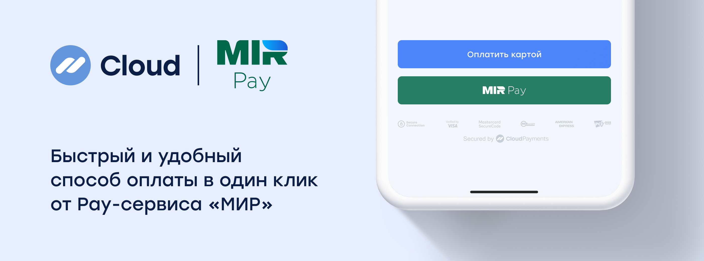
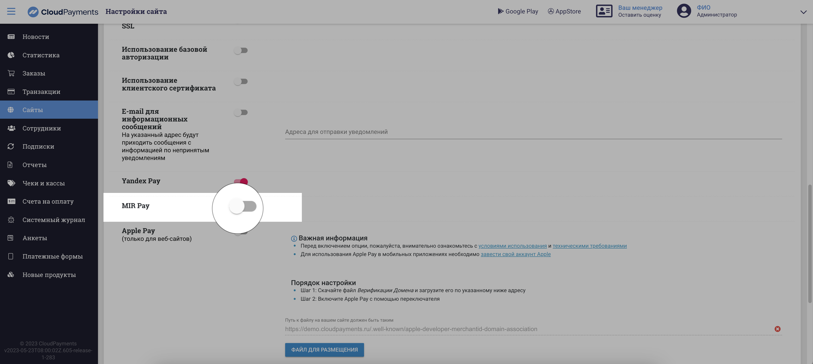

# Mir Pay

Mir Pay allows customers to pay for purchases with a single touch using Mir payment system cards. The Mir Pay button is displayed on the checkout page next to other payment methods.

## Integration options

CloudPayments offers a simplified Mir Pay integration on the checkout page via the payment widget or the mobile SDK. No additional integration with the Mir payment system service is required.

In the near future, Mir Pay will become available for other integration options, including payment blocks, orders, and payment links.

## Enable Mir Pay

**To enable the Mir Pay button in the payment widget or the mobile SDK:**

Enable the Mir Pay feature toggle in your website settings in the dashboard, or contact CloudPayments support.

### Mir Pay payment process

* After clicking the **Pay** button, the customer is redirected to the CloudPayments widget, where they can select Mir Pay without entering their card details. 
* After completing the payment, the customer sees a confirmation message and is automatically redirected back to the website. The merchant receives a transaction notification.
* The merchant does not need to perform any custom integration with the Mir payment system service; all the required functionality is provided by CloudPayments.
