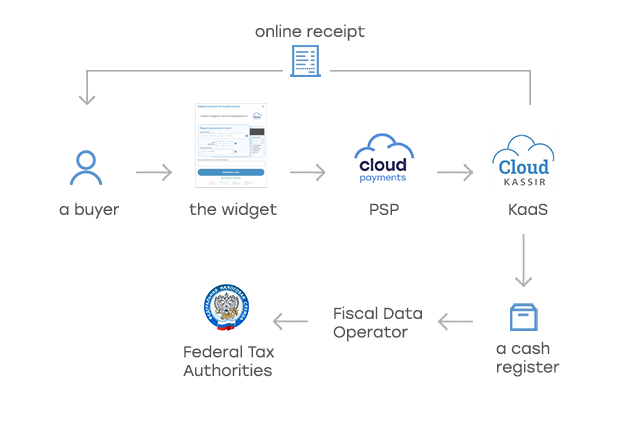
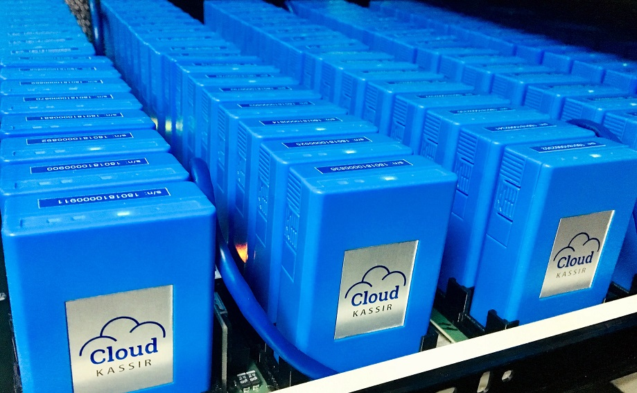

# Online cash register for online payments

## 54-FZ

Federal Law No. 54-FZ "On the Use of Cash Register Equipment," as amended on July 3, 2016, requires online services that process payments using an electronic means of payment (including bank cards) to use cash register equipment and send the customer an electronic receipt at the time of payment.

## Key provisions of the law

* You need to use a new type cash register with an installed fiscal drive.
* You need to sign a contract with a [fiscal data operator](handbook.md#fiscal-data-operators) to pass data from the cash register to the Federal Tax Service in real time.
* You need to include all product items on the receipt: name, price, quantity, amount, and VAT.
* You need to connect the cash register to the internet.
* You need to issue the receipt to the customer at the moment of payment. For online payments made with a bank card, send the receipt via email or SMS.
* You need to replace the fiscal drive in the following two cases:  
	* When it reaches the end of its service life  
	* If its memory is full before the end of its service life.  
		You also need to keep it for five years.  
* There is no need to sign a maintenance contract with a technical service center.
* There is no need to present the cash register to a tax inspector. All registration actions can be completed remotely through the taxpayer personal account on the Federal Tax Service website.

## Online fiscalization

CloudPayments offers its partners a turnkey cloud solution for online fiscalization. As part of complying with Federal Law No. 54-FZ, your business will get the following:

* Dedicated online cash register, registered with Federal Tax Service to your company
* Fiscal drive
* Connection to a fiscal data operator
* Automatic receipt generation for payments and refunds at the time of the transaction
* Full report on transactions in your profile

The cash register will be located in the data center 24/7, connected to the internet and power, operating 24 hours a day without interruptions. Our staff will monitor its technical condition and replace fiscal drives on time, while special software will fix errors, open and close shifts on schedule, queue receipts in the cloud during high load, and reliably deliver them to customers.



## Online cash register

We use MicroPay-FAS and MicroPay-FS cash registers connected to any [fiscal data operator](handbook.md#fiscal-data-operators).  



## Technology demonstration

<div  class="ck-demo">
<p> Below you can see an example of a card payment with automatic receipt generation and delivery via email or SMS. </p>
<iframe src="/slate-pages/cash_register_demo.html" width="100%" height="800px" align="baseline"  hspace="2px" vspace="2px" frameborder="1" seamless></iframe>
</div>

<div class="ck-demo-link">
<a href="/slate-pages/cash_register_demo.html">Example</a>
<p>of a card payment with automatic receipt generation and delivery via email or SMS.</p>
</div>

### Cost

The cost of online fiscalization and support services can be found on the <a href="https://cloudkassir.ru" target="_blank">CloudKassir</a> website or specified by the manager.

## How to connect

To connect online fiscalization, do the following:

* Connect to the CloudKassir online fiscalization service.
* Obtain a qualified electronic signature to work with the Federal Tax Service website.
* Register an online personal account:
    — For legal entities
    — For individual entrepreneurs
* Sign an online fiscalization agreement with CloudKassir.

After you sign the agreement and pay the invoice, you will receive the cash register number and fiscal drive number for registration with the Federal Tax Service.

## Data transmission format for online receipts

This section describes the parameters of the **receipt** object, which is passed when calling the widget or payment form builder and is responsible for generating the receipt.

For a description of the parameters used to build the **CustomerReceipt** object when calling the CloudKassir API, see the <a href="https://developers.cloudkassir.ru/#customerreceipt" target="_blank">CloudKassir</a> service documentation.

Data for the receipt must be passed in JSON format when calling the widget or payment form builder, as shown in the example below:

```js
var receipt = {
        Items: [ 
            {
                label: "Plaster", // Required field
                price: 500, // Price of a single item, required field
                quantity: 1, // Item quantity, required field
                amount: 500, // Amount (price x quantity), required field
                vat: 20, // VAT rate, required field
            },
            {
                label: "Delivery", // Required field
                price: 500, // Price of a single item, required field
                quantity: 1, // Item quantity, required field
                amount: 500, // Amount (price x quantity), required field
                vat : 20, // VAT rate, required field
            }
        ],
        amounts : {
            electronic: 1000 // Electronic payment amount
        }
    };
    
    const intentParams = {
      publicTerminalId: "test_api_00000000000000000000002", // Terminal ID
      description: "Basket of oranges", // Payment description
      paymentSchema: 'Single', // Payment scheme
      currency: "RUB", // Currency
      amount: 1000, // Amount
      receipt: receipt
    }

widget.start(intentParams).then(function(widgetResult) {
    console.log('result', widgetResult);
}).catch(function(error) {
    console.log('error', error);
});
```

**Example of using a [product list](mpf.md#список-товаров)**:

```js
var receipt = {
        Items: [ 
            {
                id: "some_id_1", // ID for searching the item in the product list
                // label: "Plaster", // Not passed, taken from the product list
                // price: 500, // Not passed, taken from the product list
                // quantity: 1, // Not passed, taken from the product list
                amount: 500, // Amount (items.price x items.count), required field
                vat: 20, // VAT rate, required field
            },
            {
                id: "some_id_2", // ID for searching the item in the product list
                // label: "Delivery", // Not passed, taken from the product list
                // price: 500, // Not passed, taken from the product list
                // quantity: 1, // Not passed, taken from the product list
                amount: 500, // Amount (items.price x items.count), required field
                vat : 20, // VAT rate, required field
            }
        ],
        amounts : {
            electronic: 1000 // Electronic payment amount
        }
    };

var items = [
              {
                id: "some_id_1",
                count: 1,
                name: "Plaster",
                price: 500,
              },
              {
                id: "some_id_2",
                count: 1,
                name: "Delivery",
                price: 500,
              },
            ],
    
    const intentParams = {
      publicTerminalId: "test_api_00000000000000000000002", // Terminal ID
      description: "Basket of oranges", // Payment description
      paymentSchema: 'Single', // Payment scheme
      currency: "RUB", // Currency
      amount: 1000, // Amount
      receipt: receipt,
      items: items
    }

widget.start(intentParams).then(function(widgetResult) {
    console.log('result', widgetResult);
}).catch(function(error) {
    console.log('error', error);
});
```


## Conditions for successful receipt creation

* The receipt contains at least one item.
* All items have their names specified.
* The price and amount of each item are non-negative.
* The total amount of all items is greater than zero.
* The product name string is no longer than 128 characters, longer strings will be truncated.
* The specified tax system must match one of the options specified in the cash register.
* Numeric values are passed with no more than two decimal places.
* The TIN is passed, if required by the documentation.

Data for the online receipt can be passed in the [widget parameters](mpf.md#параметры), when [paying by cryptogram](api/02-oplata-po-kriptogramme.md) or [token](api/04-oplata-po-tokenu-rekarring.md), when [confirming a payment](api/05-podtverzhdenie-oplaty.md), when [processing a refund](api/07-vozvrat-deneg.md), or through the special <a href="https://developers.cloudkassir.ru/#api-kassy" target="_blank">cash register API</a>.


## Send an online receipt to the customer

The customer can choose to receive the receipt by email, or by SMS, Viber, WhatsApp, or Telegram message using their phone number. The receipt can be sent automatically by the CloudPayments system, provided the customer's email or phone number is passed. Alternatively, you can send the receipt yourself, using all the necessary details the system provides in the <a href="https://developers.cloudkassir.ru/#receipt" target="_blank">Receipt</a> notification.

## When the receipt is sent

The receipt must be sent to the customer at the moment of payment. For [single-stage](general-information.md#payment-processing-methods) payments, the receipt is generated immediately after the payment is made. For [two-stage](general-information.md#payment-processing-methods) payments, it is generated when the transaction is confirmed.

Receipt generation and sending occur after the transaction status is updated to **Completed**, and these processes run asynchronously, which may take some time.

## Test the online receipt

When operating in test mode, fiscal receipts are generated using a demo cash register with a test fiscal drive. You can pass [data for the online receipt](#data-transmission-format-for-online-receipts) during a test mode payment to check that the online cash register is working properly. 


<br />
<br />
