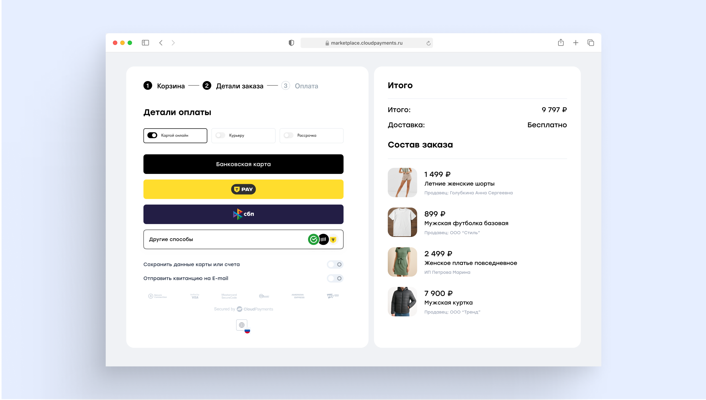

# Payment Blocks
PaymentBlocks — конструктор блоков, из которых можно собрать кастомную платежную форму. Вы можете сделать свой визуал формы

Форма оптимизирована для использования в любых браузерах и мобильных устройствах. Внутри блока открывается iframe, который гарантирует безопасность передачи карточных данных и не требует от ТСП сертификации для использования.

На форме поддерживаются все доступные в CloudPayments способы оплаты

<aside class="warning">Контроль суммы при оплате необходимо осуществлять самостоятельно. Для проверки суммы можно использовать уведомления: <a href="notifications.md#check">Check</a> - для проверки суммы до оплаты, <a href="notifications.md#pay">Pay</a> - для проверки суммы после оплаты</aside>  



## Constructor demo
Демонстрация работы Конструктора представлена [по ссылке](https://widget.cloudpayments.ru/app/demo).

Для тестирования можно использовать как [тестовые карточные данные](testing.md), так и реальные. Списания денежных средств не произойдет.

## Отличия от виджета
| Ключевые отличия | Виджет | Платежный конструктор |
|--- | --- | ---|
| Способ отображения | Попап | Встраиваемый на страницу. Можно встроить прямо на страницу заказа |
| Кастомизация |Возможность полной кастомизации <br />Так же 2 предустановленных темы: <br />2 вида:<br /><br />modern – темная тема,<br />classic – светлая тема |
| Возможность закрытия клиентом | Есть | Нет |
| Отображение суммы оплаты и назначения платежа | Да | Нет |
| Возможность обновлять данные платежа | Нет | Есть возможность подстраивать оплату под изменения в корзине |
| Возможность принудительного unmount | Нет | Есть через blocksApp.unmount() |

## Установка платежного конструктора
Для установки конструктора необходимо прописать на сайте скрипт в раздел **head**:

```js
<script src="https://widget.cloudpayments.ru/bundles/paymentblocks.js"></script>
```

Далее необходимо создать DOM-элемент для маунта

```js
<div id="element"></div>
```

Объявить платежный конструктор (подробнее параметры описываются ниже)

```js
var blocksApp = new cp.PaymentBlocks(
    initializationParams, // параметры инициализации -- обязательны для работы конструктора
    customizationParams // параметры кастомизации -- необязательны
);
```

И замаунтить его в созданный DOM-элемент

```js
blocksApp.mount(document.getElementById("element"));
```

## Unmounting from the DOM
В любой момент можно демонтировать платежный конструктор из DOM-элемента

```js
blocksApp.unmount();
```

## Events (callbacks)
Есть возможность получать уведомления о событиях и обрабатывать их, для этого необходимо добавить обработчики соответствующих событий

Для этого после маунта необходимо добавить следующий блок (или его часть)

```js
blocksApp.on("destroy", () => { // Подписка на событие ошибки оплаты
     console.log("destroy");
});
blocksApp.on("success", (result) => { // Подписка на событие успешного результата оплаты
     console.log("success", result);
});
blocksApp.on("fail", (result) => { // Подписка на событие уничтожения платежного конструктора
     console.log("fail", result);
});
```

## Callback types
| Коллбэк | Условия для формирования | Код инициализации коллбэка | Примеры result |
|--- | --- | --- | ---|
| destroy | Уничтожение платежного блока через unmount() | ```blocksApp.on("destroy", () => { console.log("destroy"); });``` | отсутствует |
| success | Успешная оплата | ```blocksApp.on("success", (result) => { console.log("success", result); });``` | ```{ "type": "payment", "data": { "transactionId": 4581868029 }, "status": "success" }``` |
| fail | Неуспешная оплата | ```blocksApp.on("fail", (result) => { console.log("fail", result); });``` | ```{ "type": "payment", "data": { "transactionId": 4581867878, "ReasonCode": 5206 }, "message": "3-D Secure авторизация не пройдена", "status": "fail" }``` |

## Unsubscribe
Так же доступна возможность отписки от событий

```js
// Отписка от событий успешного результата оплаты
blocksApp.off("success");
 
// Отписка от событий ошибки оплаты
blocksApp.off("fail");
 
// Отписка от события уничтожения платежного конструктора
blocksApp.off("destroy");
```

## Пример вызова PaymentBlocks
Пример вызова функции PaymentBlocks со всеми параметрами

```js
var blocksApp = new cp.PaymentBlocks(
{  // initializationParams -- параметры инициализации (обязательны для работы конструктора)
   "publicTerminalId":"test_api_00000000000000000000002",
   "paymentSchema":"Dual",
   "description":"Тестовая оплата",
   "amount":100.53,
   "currency":"RUB",
   "externalId":"123",
   "accountId":"123",
   "receiptEmail":"",
   "emailBehavior":"Optional",
   "language":"ru-RU"
},
{  // customizationParams -- параметры кастомизации (не обязательны)
   "appearance":{
      "colors":{
         "primaryButtonColor":"#FFB800",
         "primaryHoverButtonColor":"#E6A600",
         "primaryButtonTextColor":"#1F2937",
         "primaryButtonHoverTextColor":"#111827",
         "activeInputColor":"#00AEEF",
         "inputBackground":"#FFFFFF",
         "inputColor":"#1F2937",
         "inputBorderColor":"#D9E1E8",
         "titleColor":"#1F2937",
         "textColor":"#667085",
         "errorColor":"#E5484D",
         "skeletonBackground":"#F2F4F7"
      },
      "borders":{
         "radius":"10px"
      }
   },
   "components":{
      "paymentButton":{
         "text":"Оплатить в ТЕСТОВОМ режиме",
         "fontSize":"16px"
      },
      "paymentForm":{
         "labelFontSize":"14px",
         "activeLabelFontSize":"12px",
         "fontSize":"16px"
   }
});
```

Параметры инициализации **обязательны** для работы конструктора. Параметры кастомизации **необязательны** для работы конструктора

## Параметры инициализации
Параметры инициализации такие же, как для [виджета](mpf.md#параметры). **Обязательны** для работы конструктора

## Обновление платежного конструктора
Можно обновить все или часть параметров конструктора

Для этого нужно вызвать метод update, передав туда те же параметры (или их часть), которые использовались для инициализации платежного конструктора.

Обновляются только переданные параметры. При обновлении обязательных параметров нет, все параметры необязательные

Со списком параметров можно [ознакомиться тут](mpf.md#параметры)

```js
blocksApp.update(initializationParams);
```

## Кастомизация платежного конструктора
Кастомизация осуществляется с помощью передачи следующего набора параметров. Необходимо передать этот объект вторым аргументом в функцию инициализации конструктора

Параметры **необязательны** для работы конструктора

```js
{
   "components":{
      "paymentButton":{
         "text":"Оплатить в ТЕСТОВОМ режиме",
         "fontSize":"16px"
      },
      "paymentForm":{
         "labelFontSize":"14px",
         "activeLabelFontSize":"12px",
         "fontSize":"16px"
      }
   },
   "appearance":{
      "colors":{
         "primaryButtonColor":"#FFB800",
         "primaryHoverButtonColor":"#E6A600",
         "primaryButtonTextColor":"#1F2937",
         "primaryButtonHoverTextColor":"#111827",
         "activeInputColor":"#00AEEF",
         "inputBackground":"#FFFFFF",
         "inputColor":"#1F2937",
         "inputBorderColor":"#D9E1E8",
         "titleColor":"#1F2937",
         "textColor":"#667085",
         "errorColor":"#E5484D",
         "skeletonBackground":"#F2F4F7"
      },
      "borders":{
         "radius":"10px"
      }
   }
}
```

## Параметры кастомизации
| Уровень | Параметр | Тип | Описание | Обязательность |
|---|---|---|---|---|
| 2 | components | object | Блок кастомизации текста | Необязателен |
| 3 | .paymentButton | object | Кастомизация кнопки оплаты для карты | Необязателен |
| 4 | ..text | string | Текст кнопки оплаты | Необязателен |
| 4 | ..fontSize | string | Размер шрифта кнопки оплаты | Необязателен |
| 3 | .paymentForm | object | Кастомизация полей ввода | Необязателен |
| 4 | ..labelFontSize | string | Размер шрифта подсказки поля (замещающего текста) | Необязателен |
| 4 | ..activeLabelFontSize | string | Размер шрифта заголовка поля | Необязателен |
| 4 | ..fontSize | string | Размер шрифта текста для ввода данных | Необязателен |
| 2 | appearance | object | Кастомизация - цвета и скругление | Необязателен |
| 3 | .colors | object | Цвета для различных объектов | Необязателен |
| 4 | ..primaryButtonColor | string | Цвет кнопки оплаты | Необязателен |
| 4 | ..primaryButtonTextColor | string | Цвет текста кнопки оплаты | Необязателен |
| 4 | ..primaryHoverButtonColor | string | Цвет кнопки оплаты при наведении | Необязателен |
| 4 | ..primaryButtonHoverTextColor | string | Цвет текста кнопки оплаты при наведении | Необязателен |
| 4 | ..activeInputColor | string | Цвет значения полей | Необязателен |
| 4 | ..inputBackground | string | Цвет фона полей | Необязателен |
| 4 | ..inputColor | string | Цвет текста лейблов | Необязателен |
| 4 | ..inputBorderColor | string | Цвет обводки полей ввода | Необязателен |
| 4 | ..errorColor | string | Цвет ошибки ввода | Необязателен |
| 4 | ..skeletonBackground | string | Цвет скелетона | Необязателен |
| 4 | ..titleColor | string | Цвет заголовков | Необязателен |
| 4 | ..textColor | string | Цвет текста | Необязателен |
| 3 | .borders | object | Границы формы | Необязателен |
| 4 | ..radius | string | Радиус скругления углов формы | Необязателен |
