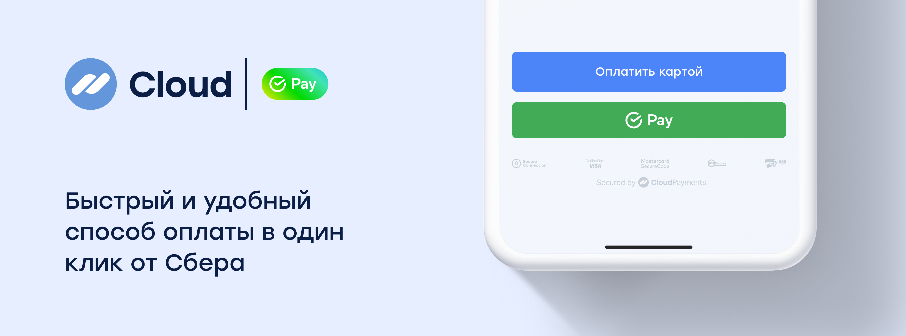

# SberPay



CloudPayments provides one-click payments via SberPay.  Customers can pay using any of their accounts in the Sber app, and earn “Spasibo” reward points for future purchases.

## Get payment link

### Description
Method for getting the payment link to redirect the customer to the bank’s mobile app. The response returns the `QrUrl` parameter containing the redirect URL.

To process the payment, redirect the customer to the received URL.

This method does not require <a href="https://en.wikipedia.org/wiki/Basic_access_authentication" target="_blank">HTTP Basic Auth</a>. Instead, the request uses the `PublicId` parameter in the request body to identify the terminal.

### Endpoint
https://api.cloudpayments.ru/payments/qr/sberpay/link

### Request parameters

Parameter | Format | Required | Description
--------- | ------- | ----------- | -----------
PublicId |	string | Yes |	Website ID, can be found in the dashboard
Amount | decimal | Yes | Payment amount in rubles. Use a dot as the decimal separator. Number of decimal places: 2
Currency | string | Yes | Currency: RUB (see [currency list](handbook.md#list-of-currencies))
Description | string | No | Payment description (free-form)
AccountId | string | No | User ID, required to create a subscription and obtain a token
Email | string | No | Payer email for receiving payment confirmation
JsonData | JSON | No | Any other data associated with the transaction, including [instructions](api/17-sozdanie-podpiski-na-rekurrentnye-platezhi.md) for creating a subscription or generating an [online receipt](online-kassa.md#data-transmission-format-for-online-receipts), must be wrapped in the `cloudpayments` object. We have reserved the names of the following parameters and their values are displayed in the transaction register downloaded from the dashboard: `name`, `firstName`, `middleName`, `lastName`, `nick`, `phone`, `address`, `comment`, `birthDate`
InvoiceId | string | No | Account number/ID<br /><br />Passed in the `Check` notification and can be used to validate the order number
Scheme | enum string | Yes | Payment processing method (view [Transaction types](handbook.md#operation-types)). <br />Possible values:<br />`charge` for single-stage payment<br /> `auth` for two-stage payment
SuccessRedirectUrl | string | No | Customer redirect URL after a successful payment. <br />Once the payment is processed, the customer will be redirected from the bank's mobile app to the specified URL.
IpAddress | string | No | Payer IP address
Os | string | Yes | Payer's device operating system. <br />Example values: `Android`, `iOS`, `Windows`
Webview | bool | Yes | Indicator of whether the browser is running in WebView mode. <br />Possible values:<br />`true` for payments using webview<br /> `false` for payments without webview
Device | string | Yes | Payer's device type flag. <br />Possible values: <br />`MobileApp`  for payments initiated from a mobile app<br />`DesktopWeb`  for payments initiated from a desktop browser<br />`Mobile` for payments initiated from a mobile browser
Browser | string | Yes  | Customer browser name based on browser userAgent. <br />Example values: `Chrome`, `Firefox`, `MIUI Browser`, `Opera`

The server returns a JSON response with the following three properties:

- **Success**: request result
- **Message**: error description
- **Model**: additional information

Response examples:

1. Malformed request
  - **Success**: false
  - **Message**: error description
2. Transaction declined:
  - **Success**: false
  - **Model**: transaction information and error code
3. Transaction accepted:
  - **Success**: true
  - **Model**: transaction information

<aside class="notice">Request result from the <code>Success</code> field does not reflect transaction status; it only indicates the success or failure of the API request. Transaction status is reflected in the additional <code>Status</code> field, and can also be obtained via received <a href="notifications.md">notifications</a>. For the interpretation of transaction statuses, see <a href="handbook.md#transaction-statuses">reference</a>.</aside>

### Example request

```json
{
    "PublicId": "test_api_00000000000000000000002",
    "Amount": 1000,
    "Currency": "RUB",
    "Description": "Payment via SberPay",
    "AccountId": "email@email.com",
    "Email": "email@email.com",
    "InvoiceId": "order_no4009",
    "Scheme": "charge",
    "SuccessRedirectUrl": "https://cp.ru",
}
```

### Example response

```json
{
    "Model": {
        "QrUrl": "sberpay://invoicing/v2?bankInvoiceId=5628ecb3ef514a48abed24e16f818f03&operationType=Web2App", // Contains the redirect URL
        "QrImage": null,
        "TransactionId": 11122233344, // CloudPayments transaction ID
        "Amount": 10
    },
    "Success": true,
    "Message": null
}
```

## Get QR code for payment

### Description
Method for getting the QR code to show the customer in the browser. Response will return the `QrImage` parameter containing a QR code in imageSVG format for customer display. The string value is base64-encoded.

This method does not require <a href="https://en.wikipedia.org/wiki/Basic_access_authentication" target="_blank">HTTP Basic Auth</a>. Instead, the request uses the `PublicId` parameter in the request body to identify the terminal.

### Endpoint
https://api.cloudpayments.ru/payments/qr/sberpay/image

### Request parameters
[See SberPay. Get a payment link](#request-parameters)

### Example request
[See SberPay. Get a payment link](#example-request)

### Example response

```json
{
    "Model": {
        "QrUrl": null,
        "QrImage": {string}, // Contains Base64-encoded SVG
        "TransactionId": 11122233344, // CloudPayments transaction ID
        "Amount": 10
    },
    "Success": true,
    "Message": null
}
```
