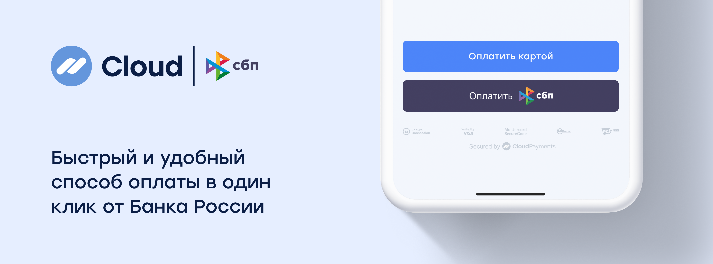

# SBP



CloudPayments offers a one-click payment method via the SBP (Faster Payments System). The buyer can select any bank to make the payment through the Faster
Payments System.

## Get a payment link

### Description
Method for getting the payment link to redirect the customer to the bank’s mobile app. The response returns the `QrUrl` parameter containing
the redirect URL.

To process the payment, redirect the customer to the received URL.
### Endpoint
https://api.cloudpayments.ru/payments/qr/sbp/link

### Request parameters

Parameter | Format | Required | Description
--------- | ------- | ----------- | -----------
PublicId |	string |	Yes |	Website ID, can be found in the dashboard
Amount | decimal | Yes| Payment amount in rubles. Use a dot as the decimal separator. Number of decimal places: 2
Currency | string | Yes| Currency: RUB (see the [reference](handbook.md#list-of-currencies))
Description | string | No | Payment description (free-form)
AccountId | string | No | User ID, required to create a subscription and obtain a token
Email | string | No | Payer email for receiving payment confirmation
JsonData | JSON | No | Any other data associated with the transaction, including [instructions](api/17-sozdanie-podpiski-na-rekurrentnye-platezhi.md) for creating a subscription or generating an [online receipt](online-kassa.md#data-transmission-format-for-online-receipts), must be wrapped in the `cloudpayments` object. We have reserved the names of the following parameters and their values are displayed in the transaction register downloaded from the dashboard: `name`, `firstName`, `middleName`, `lastName`, `nick`, `phone`, `address`, `comment`, `birthDate`
InvoiceId | string | No | Invoice number/ID<br /><br />Passed in the `Check` notification and can be used to validate the order number
Scheme | enum string | Yes | Payment processing method (see [Transaction types](handbook.md#operation-types)) <br />Possible meanings: `charge` (single-stage payment)
SuccessRedirectUrl | string | No | Customer redirect URL after a successful payment. Once the payment is processed, the customer will be redirected from the bank's mobile app to the specified URL.<br />The value must not exceed 1024 characters, must be ASCII-encoded, and must comply with the RFC 3986 specification format
IpAddress | string | No | Payer IP address
Os | string | No | Payer's device operating system <br />Example values: `Android`, `iOS`, `Windows`
Webview | bool | No | Indicator of whether the browser is running in WebView mode. <br />Possible values: `true` for payments using webview, `false` for payments without webview
Device | string | No | Payer's device type flag <br />Possible values: <br />`MobileApp` for payments initiated from a mobile app <br />`DesktopWeb` for payments initiated from a desktop browser <br />`Mobile` for payments initiated from a mobile browser
Browser | string | No | Customer's browser name derived from the browser's `User-Agent` string. <br />Example values: `Chrome`, `Firefox`, `MIUI Browser`, `Opera`
TtlMinutes | int | No | Time window during which the payment via QR code or payment link remains available. Minimum allowable value: `1`. The maximum allowable value: `129 600` (90 days).<br />If this parameter is omitted, the payment can be completed within 72 hours
SaveCard | bool | No | Indicator of whether to save the card to link the account within the National Payment Card System for subsequent charges
IsTest | bool |	No | Test mode flag


The server returns a JSON response with the following three properties:

- **Success**: request result
- **Message**: error description
- **Model**: additional information

Response examples:

1. Malformed request:
  - **Success**: false
  - **Message**: error description
2. Transaction declined:
  - **Success**: false
  - **Model**: transaction information and an error code
3. Transaction accepted:
  - **Success**: true
  - **Model**: transaction information

<aside class="notice">The request result (the <code>Success</code> field) does not reflect the transaction status; it only indicates the success or failure of the API request. The transaction status is reflected in the additional <code>Status</code> field, and can also be obtained via received <a href="notifications.md">notifications</a>. For the interpretation of transaction statuses, see <a href="handbook.md#transaction-statuses">reference</a>.</aside>

### Request example

```json
{
    "PublicId": "test_api_00000000000000000000002",
    "Amount": 1000,
    "Currency": "RUB",
    "Description": "Payment by SBP",
    "AccountId": "email@email.com",
    "Email": "email@email.com",
    "InvoiceId": "order_no4009",
    "Scheme": "charge",
    "SuccessRedirectUrl": "https://cp.ru",
    "SaveCard": false
}
```

### Response example

```json
{
    "Model": {
        "QrUrl": "{URL-address}", // Contains the redirect URL
        "QrImage": null,
        "TransactionId": 11122233344, // CloudPayments transaction ID
        "MerchantOrderId": "12345", // Passed InvoiceId
        "ProviderQrId": "BB1S004HCK9PFD0F996RJI3208UE", // Passed payment link or QR code ID
        "Amount": 10,
        "Message": "Created",
        "IsTest": false
    },
    "Success": true,
    "Message": null
}
```

## Get a QR code for payment

### Description
Method for getting the QR code to show the customer in the browser. The response returns the `QrImage` parameter containing the QR code in imagePNG format for customer display. The string value is Base64-encoded.

To process the payment, redirect the customer to the received URL. Customers can complete a payment an unlimited number of times using a single SBP QR code.
### Endpoint
https://api.cloudpayments.ru/payments/qr/sbp/image

### Request parameters
[See SBP, Get a payment link](#request-parameters)

### Request example
[See SBP, Get a payment link](#request-example)

### Response example

```json
{
    "Model": {
        "QrUrl": null,
        "QrImage": {string}, // Contains the base64-encoded PNG image
        "TransactionId": 11122233344, // CloudPayments transaction ID
        "MerchantOrderId": "12345", // Passed InvoiceId
        "ProviderQrId": "BB1S004HCK9PFD0F996RJI3208UE", // Passed payment link or QR code ID
        "Amount": 10,
        "Message": "Created",
        "IsTest": false
    },
    "Success": true,
    "Message": null
}
```

## List of SBP participants

### Description
Method returns the list of Faster Payments System (SBP) participants based on the customer's platform. The data source is the [SBP widget API](https://widget.cbrpay.ru/#membersListV2).

### Endpoint
https://api.cloudpayments.ru/sbp/v2/banks/info

### Request parameters
| Parameter | Type | Required | Description |
|---------|------|----------------|-----------|
| AccountId | string | No | User account ID |
| IsRenewSubscription | bool | No | Subscription update flag |
| JsonData | string | No | Additional data in JSON format |
| Platform | string | No | Customer's platform (desktop, iOS, Android) |
| PublicTerminalId | string | Yes | Public ID of the terminal |
| SaveCard | bool | No | Indicator of whether to save the card |
| Token | string | No | Card token to be saved |

### Request example
```json
{
  "PublicTerminalId": "pk_1234567890abcdef",
  "Platform": "ios"
}
```

### Response parameters
| Parameter | Type | Description |
|---------|------|-----------|
| Success | bool | Request success flag |
| Message | string | Error description in case of failure (`null` if successful) |
| Model | list&lt;SbpMemberDto&gt; | List of SBP participant data |
| Model.Source | string | Data source |
| Model.Version | string | Response specification version |
| Model.Members | list&lt;SbpMemberDataDto&gt; | List of SBP participants |
| Model.Members.Id | string | Unique ID of SBP participant |
| Model.Members.Name | string | Full name of the bank or SBP participant |
| Model.Members.Logo | string | URL of the bank logo |
| Model.Members.Url | string | Redirect URL to the bank's mobile app or web-banking portal |

### Response example
```json
{
  "Success": true,
  "Message": null,
  "Model": [
    {
      "Source": "widget",
      "Version": "2.0",
      "Members": [
        {
          "id": "100000000111",
          "logo": "https://qr.nspk.ru/proxyapp/logo/bank100000000111.png",
          "name": "Sberbank",
          "url": "bank100000000111://qr.nspk.ru/{QRC_ID}{QUERY_STRING}"
        },
        {
          "id": "100000000004",
          "logo": "https://qr.nspk.ru/proxyapp/logo/bank100000000004.png",
          "name": "T‑Bank",
          "url": "https://www.tinkoff.ru/mybank/payments/qr-pay/{QRC_ID}{QUERY_STRING}"
        },
        {
          "id": "100000000005",
          "logo": "https://qr.nspk.ru/proxyapp/logo/bank100000000005.png",
          "name": "VTB Bank",
          "url": "https://online.vtb.ru/i/paymentSbp/{QRC_ID}{QUERY_STRING}"
        }
      ]
    }
  ]
}
```

## Refund
The refund method for SBP operations is identical to the refund method used for online acquiring operations. See [API, Refund](api/07-vozvrat-deneg.md).

SBP refunds operate asynchronously. The final SBP refund status ("Completed" or "Declined") can be obtained via a [Refund](notifications.md#refund) notification after the refund transaction has been created, rather than within the immediate response to the refund request itself.

## Notifications
Notifications for SBP operations are identical to notifications for internet acquiring operations. See [Notifications](notifications.md).

The parameter responsible for the operation type within the notification is `PaymentMethod` (which is set to `Sbp` for SBP transactions).

If `Check` notifications are enabled, a `Check` request will be sent prior to generating the QR code or payment link to validate the data accuracy

## Generate direct links and the bank list
A direct link redirects the payer to a specific bank's mobile app when clicked.

The bank list can be retrieved from the array of elements returned in the response to the request [POST: /sbp/v2/banks/info](#list-of-sbp-participants) in the `Model.Members` parameter.

CloudPayments utilizes the participant list retrieved from the [SBP widget API](https://widget.cbrpay.ru/#membersListV2).

### SBP integration requirements

**Must remain unchanged:**

1. **Bank order:** the original sequence of banks must not be altered (the original order is maintained by CloudPayments)
2. **Names and logos**
3. **URLs used to redirect customers to banking applications**

**Required:**

1. Bank search feature (must be preserved)
2. Data caching (enforced on the CloudPayments side):
  - Use only data that is no more than 24 hours old
  - In the event of a request failure, use the latest available working data

**Allowed customization:**

- Display the top 3 banks previously selected by the customer

### Specifications of SBP bank list display

**List element ordering**

1. Elements on the bank selection page must be arranged strictly in the order returned in the response to the [POST /sbp/v2/banks/info](#list-of-sbp-participants) request.
2. Exception:
   - A maximum of 3 previously selected banks may be displayed at the top of the list.
   - The remaining banks must follow in their original sequence, excluding those already moved to the top.

**Bank logo**

The bank logo must be retrieved from the  response to the [POST /sbp/v2/banks/info](#list-of-sbp-participants) request, using the `Model.Members.logo` parameter

**Bank name**

The bank name must be retrieved from the response to the [POST /sbp/v2/banks/info](#list-of-sbp-participants) request, using the `Model.Members.Name` parameter

**Link to the bank app**

To generate a direct link that redirects the customer to a specific bank's mobile application, use the following steps:

1. Retrieve the payment link from the response to the [POST /payments/qr/sbp/link](#get-a-payment-link) request, using the `Model.QrUrl` parameter.
2. Retrieve the bank link template from the response to the [POST /sbp/v2/banks/info](#list-of-sbp-participants) request, using the `Model.Members.url` parameter.
3. Process the link template:
   - Remove the trailing path element: `{QRC_ID}{QUERY_STRING}`.
4. Generate the final link:
   - Concatenate the remaining part of the template with the path and query parameters extracted from the payment link.

**URL transformation example**

1. Payment link: `https://qr.nspk.ru/AD1000XXXXX1000?type=02&bank=100000000004&sum=1299900&cur=RUB&crc=8DA8`
2. Link template: `https://online.vtb.ru/i/paymentSbp/{QRC_ID}{QUERY_STRING}`
3. Resulting link: `https://online.vtb.ru/i/paymentSbp/AD1000XXXXX1000?type=02&bank=100000000004&sum=1299900&cur=RUB&crc=8DA8`
