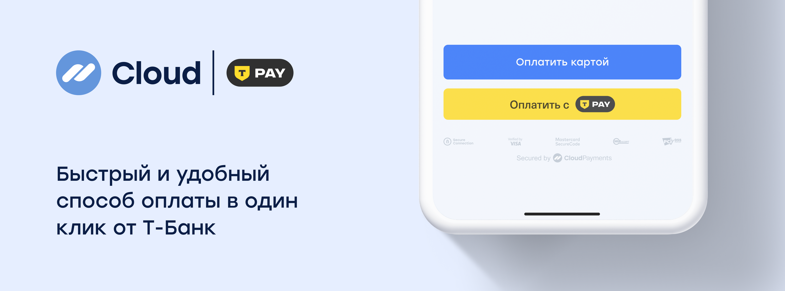

# T-Pay



CloudPayments offers a one-click payment method through T‑Pay. The customer can choose any payment account in the T-Bank app, as well as earn T-Bank cashback for future purchases.

T-Pay payments can be accepted through the SDK. You can implement this either through the CloudPayments payment form or as a separate button.

See the documentation for more details:

- SDK for [iOS](sdk-ios.md)
- SDK for [Android](sdk-android.md)

## Get a payment link
### Description
Method for getting the payment link to redirect the customer to the bank’s mobile app.
The response will return the `QrUrl` parameter with the redirect URL.

To process the payment, redirect the customer to the received URL.

### Endpoint
https://api.cloudpayments.ru/payments/qr/tinkoffpay/link

### Request parameters

Parameter | Format | Required | Description
--------- | ------- | ----------- | -----------
publicId |	string |	Yes |	Website ID, can be found in the dashboard
Amount | decimal | Yes| The payment amount in the transaction currency. Use a dot as the decimal separator. Number of decimal places: 2
Currency | string | Yes| Currency: RUB (see the [reference](handbook.md#list-of-currencies))
Scheme | enum string | Yes | Payment processing method (see [Transaction types](handbook.md#operation-types)) <br />Possible values: `0` for single-stage payment, `1` for two-stage payment
Browser | string | Yes | Customer's browser name derived from the browser's `User-Agent` string. <br />Example values: `Chrome`, `Firefox`, `MIUI Browser`, `Opera`
Os | string | Yes | Payer's device operating system <br />Example values: `Android`, `iOS`, `Windows`
Webview | bool | Yes | Indicator of whether the browser is running in WebView mode. <br />Possible values: `true` for payments using webview, `false` for payments without webview
Device | enum string | Yes | Payer's device type flag <br />Possible values: <br />`MobileApp` for payments initiated from a mobile app <br />`DesktopWeb` for payments initiated from a desktop browser <br />`Mobile` for payments initiated from a mobile browser
SuccessRedirectUrl | string | Yes |Customer redirect URL after a successful payment. <br />Once the payment is processed, the customer will be redirected from the bank's mobile app to the specified URL
FailRedirectUrl | string | Yes | URL for redirecting the customer after a failed payment. <br />Once the payment is processed, the customer will be redirected from the bank's mobile app to the specified URL
IpAddress | string | No | Payer IP address
AccountId | string | No | User ID
Email | string | No | Payer email
InvoiceId | string | No | Invoice or order number
Description | string | No | Payment description (free-form)
JsonData | JSON | No | Any other data associated with the transaction, including [instructions](api/17-sozdanie-podpiski-na-rekurrentnye-platezhi.md) for creating a subscription or generating an [online receipt](online-kassa.md#data-transmission-format-for-online-receipts), must be wrapped in the `cloudpayments` object. We have reserved the names of the following parameters and their values are displayed in the transaction register downloaded from the dashboard: `name`, `firstName`, `middleName`, `lastName`, `nick`, `phone`, `address`, `comment`, `birthDate`
TtlMinutes | int | No | Time window during which the payment via QR code or payment link remains available. <br />If this parameter is omitted, the payment can be completed within 24 hours.<br />**Important:**<br />\- `0` is considered **incorrect** and may lead to a request processing error.<br />\- If the time limit is not required, either **do not pass** this parameter or explicitly set it to `null`
SaveCard | bool | No | Flag indicating whether to save the card token for payments via a stored card (see [Payment by token (recurring)](api/04-oplata-po-tokenu-rekarring.md)). <br />Possible values: `true`: after a successful payment, the card token will be returned, `false`: the token will not be returned (default) <br />The `SaveCard` parameter is only processed when the "Save a card token" setting is enabled in the dashboard. If the "Force Save" setting is enabled, the `SaveCard` parameter will be ignored

The server returns a JSON response with the following three properties:

- **Success**: request result
- **Message**: error description
- **Model**: additional information

Response examples:

1. Malformed request:
  - **Success**: false
  - **Message**: error description
2. Transaction declined:
  - **Success**: false
  - **Model**: transaction information and an error code
3. Transaction accepted:
  - **Success**: true
  - **Model**: transaction information

<aside class="notice">The request result (the <code>Success</code> field) does not reflect the transaction status; it only indicates the success or failure of the API request. The transaction status is reflected in the additional <code>Status</code> field, and can also be obtained via received <a href="notifications.md">notifications</a>. For the interpretation of transaction statuses, see <a href="handbook.md#transaction-statuses">reference</a>.</aside>

### Request example
```json
{
    "Amount" : "10",
    "AccountId": "someId",
    "InvoiceId": 12345,
    "Browser" : "Chrome",
    "Currency" : "RUB",
    "Device" : "Mobile",
    "Description" : "Payment with T‑Pay",
    "Email" : "email@email.com",
    "IpAddress": "123.123.123.123",
    "Os" : "Android",
    "Scheme" : 1,
    "TtlMinutes" : 30,
    "SuccessRedirectUrl" : "https://cp.ru",
    "FailRedirectUrl" : "https://cp.ru",
    "Webview" : false
}

```

### Response example

```json
{
    "Model": {
        "QrUrl": "{URL-address}", // Contains the redirect URL
        "QrImage": null,
        "TransactionId": 11122233344, // CloudPayments transaction ID
        "MerchantOrderId": "12345", // Passed InvoiceId
        "ProviderQrId": "",
        "Amount": 10,
        "Message": "Created",
        "IsTest": false
    },
    "Success": true,
    "Message": null
}
```


## Get a QR code for payment
### Description
Method for getting the QR code to show the customer in the browser.
Response will return the `QrImage` parameter containing a QR code in imageSVG format for displaying to the customer. The string value is Base64-encoded.

Endpoint:
https://api.cloudpayments.ru/payments/qr/tinkoffpay/image

### Request parameters
[See also T‑Pay. Get a payment link](#get-a-payment-link)

### Request example
[See also T‑Pay. Get a payment link](#get-a-payment-link)

### Response example
```json
{
    "Model": {
        "QrUrl": null,
        "QrImage": {string},  // Contains a Base64-encoded SVG
        "TransactionId": 11122233344, // CloudPayments transaction ID
        "MerchantOrderId": "12345", // Passed InvoiceId
        "ProviderQrId": "",
        "Amount": 10,
        "Message": "Created",
        "IsTest": false
    },
    "Success": true,
    "Message": null
}
```
